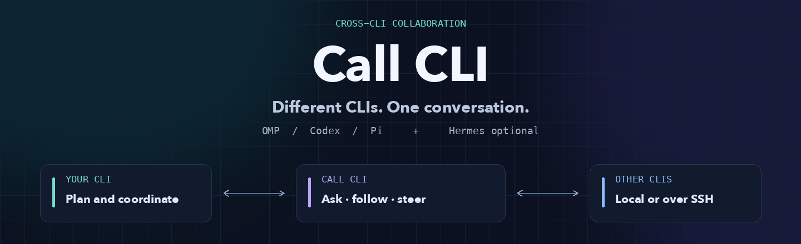

<div align="center">



**Give your CLI a teammate, not just another subprocess.**

<a href="README.md"><strong>English</strong></a> · <a href="README.zh-CN.md">简体中文</a>

<a href="VERIFICATION.md"></a>
<a href="https://github.com/openclaw/acpx"></a>
<a href="LICENSE"></a>

[Quick start](#quick-start) · [Choose an entry](#choose-your-entry) · [How it works](#how-it-works) · [Documentation](#documentation)

</div>

---

Call CLI connects **OMP, Codex and Pi** through a lightweight coordination layer. Start a fresh session, follow its progress, answer its questions and change direction while it works — **locally or over your existing SSH connections**.

**No mandatory Hermes dependency. No additional always-on service. No takeover of your existing terminal sessions.**

## Why Call CLI?

You plan in one CLI. Another agent implements on a different machine. A third reviews the result. Questions and revisions travel back through the initiating CLI, instead of being copied between terminals by hand.

| | Capability | What you get |
| :-- | :-- | :-- |
| 💬 | **A real conversation** | Answer numbered questions and continue the same target session. |
| 📡 | **Progress you can act on** | Short, cursor-based waits return public stages, tool status, questions and results. |
| 🧭 | **Direction stays with you** | The initiating CLI can intervene proactively or relay your new instructions. |
| 🌐 | **Local or cross-device** | One POSIX coordinator reaches execution devices through existing SSH. |
| 🔒 | **Honest execution state** | Authoritative Shared Runtime results; unknown outcomes are not silently replayed. |

## Quick start

### Ask your AI to set it up

Paste this into the OMP, Codex, Pi or Hermes session you already use:

```text
Read the README and docs/configuration.md in
https://github.com/Loveacup/call-cli, then set up Call CLI for this CLI.

Discover the existing installation, SSH aliases, logins and workspaces first.
Install only the entry, skill or module I need. Preserve existing files and
credentials; do not create an always-on service. Explain the first-turn npm
check and possible global ACPX patch update before starting a task.

Verify with a real read-only collaboration, close your test sessions,
and report what works and what remains blocked.
```

The setup guide is **an execution manual for AI**, not a new configuration file for you to fill in. The detailed AI guides are currently in **Simplified Chinese**; both README editions cover the same product scope.

<details>
<summary><strong>Prefer the terminal? Run directly from source.</strong></summary>

#### Prerequisites

- **Coordinator:** POSIX Python with `fcntl`. The core path has been verified on macOS; Windows is a client/execution-device option, not a Python coordinator.
- **Execution device:** Node.js, npm, ACPX and a configured, authenticated target CLI.
- **Verified baseline:** ACPX **0.20.0**, which requires Node.js **22.13.0+**. See the [AI setup guide](docs/configuration.md) for adapter configuration and platform limits.

```sh
git clone https://github.com/Loveacup/call-cli.git
cd call-cli
python3 collab.py --help
acpx --version
```

Call CLI is currently source-distributed: no published Call CLI npm/pip package or universal one-line installer.

#### Start a read-only collaboration

Run this in the same POSIX shell, from the checkout. No write permission is granted.

```sh
CALL_CLI_HOME="$PWD"
CALL_CLI_DB="$HOME/.local/state/call-cli/tasks.sqlite3"

CLIENT_ID="$(python3 "$CALL_CLI_HOME/collab.py" --db "$CALL_CLI_DB" \
  connect --runtime omp | python3 -c 'import json,sys; print(json.load(sys.stdin)["client_id"])')"

TASK_ID="$(python3 "$CALL_CLI_HOME/collab.py" --db "$CALL_CLI_DB" \
  --client "$CLIENT_ID" start --device local --agent omp --cwd "$PWD" \
  --timeout 120 --prompt 'Read this project and summarize its main entry points. Do not modify files.' \
  | python3 -c 'import json,sys; print(json.load(sys.stdin)["id"])')"

python3 "$CALL_CLI_HOME/collab.py" --db "$CALL_CLI_DB" --client "$CLIENT_ID" \
  wait --task "$TASK_ID" --after 0 --timeout 5
```

Keep the real client/task IDs and the returned `after` cursor. Continue short waits; answer the returned question ID with `reply`, or use a stable command ID with `intervene`. After the turn settles, verify the result and call `close`. Closing a running task is not a substitute for cancellation.

A client ID is a local capability handle; `--runtime omp` is a declaration, not authenticated native provenance. See the [collaboration guide](docs/usage.md) for exact commands and cleanup.

</details>

> **Before your first task:** v0.2.x checks npm's stable ACPX version and may globally install a compatible patch when its source, version and idle checks allow it. There is currently no disable-update switch. Review this behavior and obtain the needed authorization before using a frozen environment. [Details](docs/configuration.md#acpx-版本检查与更新)

## Choose your entry

| You work in… | Use | Scope |
| :-- | :-- | :-- |
| A terminal or script | `python3 collab.py` | The complete generic coordination API. |
| OMP, Codex or Pi | The `skill/` bundle + a configured entry | AI-operated collaboration; skills do not install dependencies or authenticate agents. |
| Another machine | `remote-client.cjs` | One-shot SSH transport to the coordinator. |
| A restricted Windows Codex environment | `remote-client.ps1` | Native PowerShell/.NET alternative to the observed Node SSH spawn `EPERM`; verified with a macOS coordinator only. |
| Hermes | Optional `call_cli` plugin | Native source binding and background notifications; it does **not** expose the generic `intervene` action. |

**Terminal installation and in-CLI loading belong to the same setup path.** The [integration guide](docs/integrations.md) shows which layer to install, how the AI loads it, and how to verify the actual entry without stacking conflicting installs.

## How it works

```text
Your CLI                         Call CLI                       Target CLI
   │                                │                               │
   ├──────── start a task ──────────►│──── local / SSH + ACPX ────────►│
   │◄──── progress / questions ──────┤◄──── public events ─────────────┤
   ├──────── reply / intervene ─────►│──── same-session continuation ─►│
   │◄──── result + cleanup state ────┤◄──── authoritative turn result ─┤
```

The coordinator owns a small SQLite task store and bounded workers. ACPX supplies the native session and queue-owner lifecycle. Its public `acpx/runtime` API provides the authoritative `turn.result`; public events serve progress and questions, not guesses about final settlement.

Intervention is explicit: **request → cancel the old turn → confirm settlement → continue the same session → verify the revised result**. It is not a promise of universal lossless hot-editing or pause/resume.

## Documentation

### For the AI operating Call CLI

| Guide | What it covers | Language |
| :-- | :-- | :-- |
| [Installation & configuration](docs/configuration.md) | Environment discovery, SSH, adapters, authentication, permissions and acceptance. | 简体中文 |
| [CLI & module integration](docs/integrations.md) | Terminal installation, skill loading and the optional Hermes plugin. | 简体中文 |
| [Online collaboration](docs/usage.md) | Progress, Q&A, intervention, cancellation, verification and closure. | 简体中文 |
| [Windows Codex SSH](CODEX_SSH.md) | Desktop-context execution and native PowerShell client templates. | 简体中文 |

### For users and contributors

[Verification](VERIFICATION.md) · [Roadmap](ROADMAP.md) · [Security](SECURITY.md) · [Contributing](CONTRIBUTING.md)

<details>
<summary><strong>Scope and safety — read before granting access</strong></summary>

- **Fresh collaboration sessions only.** No takeover of manually opened terminals, TUIs or desktop GUIs.
- `queued`/`pending` means submitted, not applied. Reconcile `unknown`/`DO_NOT_REPLAY` before retrying.
- `--write` selects ACPX `approve-all`. It is an approval policy, **not a filesystem sandbox**; SSH and the target agent retain the configured OS user's permissions.
- Keep databases, handles, prompts, answers and authentication private. “Public event” does not mean sanitized content.
- One coordinator owns state and locks. Distributed locking across coordinators, restart recovery and automatic wakeup after leaving the collaboration are not promised.
- Source tests, installed-entry checks and complete platform/CLI coverage are different claims. See [verification](VERIFICATION.md).

</details>

## Development

The Python core uses the standard library. The **v0.2.3 baseline** is 59 Python discovery cases (58 passed, one opt-in native integration skipped), 11 Node facade cases, and four separately run native integration scenarios. The native endpoint is a clearly synthetic fixture, not a live model.

```sh
python3 -B -m unittest discover -v
node --test test_shared_prompt.cjs
node --test test_codex_ssh.cjs
# Optional: owned native ACPX sessions, synthetic endpoint, no model call
RUN_NATIVE_ACPX_TESTS=1 python3 -B -m unittest -v test_native_shared
```

Live model and cross-device checks require authorized execution and existing logins. Private run records are not distributed. The optional artwork renderer in `docs/assets/` uses Pillow; it is **not** a runtime dependency.

## Acknowledgements

Built on [ACPX](https://github.com/openclaw/acpx) and the native capabilities of the target CLIs. Call CLI is not affiliated with those projects.


<div align="center">

**Different tools. Shared direction.**

[MIT License](LICENSE) · [简体中文](README.zh-CN.md)

</div>
