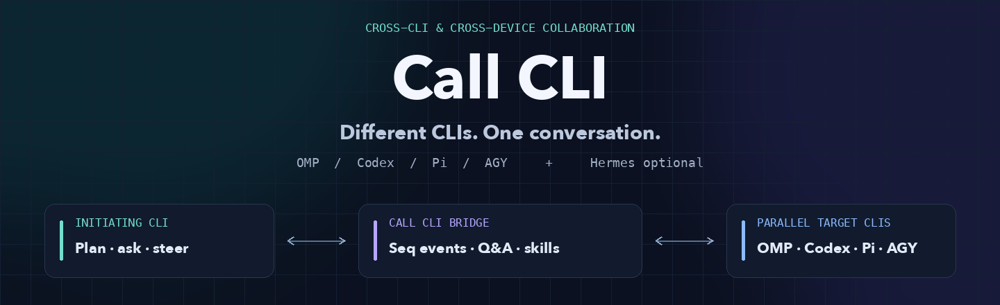
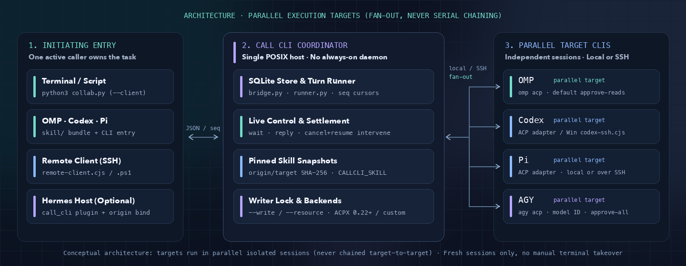

<div align="center">



**Give your CLI a teammate, not just another subprocess.**

<a href="README.md"><strong>English</strong></a> · <a href="README.zh-CN.md">简体中文</a>

<a href="https://github.com/openclaw/acpx"></a>
<a href="LICENSE"></a>

[Quick start](#quick-start) · [Choose your entry](#choose-your-entry) · [Core capabilities](#capabilities) · [Architecture & lifecycle](#how-it-works) · [Evidence & boundaries](#evidence-and-boundaries) · [Documentation](#documentation)

</div>

---

Call CLI connects **OMP, Codex, Pi and AGY** through a lightweight coordination layer. Start a fresh collaboration session, follow its live progress, answer numbered questions, pass task-pinned skills and steer direction while it works — **locally or over your existing SSH connections**.

**What it is not:** No mandatory Hermes dependency. No additional always-on service or daemon. No takeover of your manually opened terminal, TUI or desktop GUI sessions.

## Why Call CLI?

You plan in one CLI. Another agent implements on the same machine or over SSH. A third reviews the result in parallel. Stage progress, numbered questions, pinned skill bundles and mid-run course corrections travel back and forth through the initiating CLI instead of being copied between terminals by hand.

| | Capability | What you get |
| :-- | :-- | :-- |
| 💬 | **Continuous Q&A & live steering** | Answer numbered questions (`CALLCLI_QUESTION`) with `reply`, or redirect a running task with `intervene` (cancel → confirm settlement → resume in the same target session). |
| 📡 | **Resumable event stream (`seq`)** | Bounded `wait` and `events --after SEQ` return public stages (`CALLCLI_STAGE`), deduplicated safe tool statuses, pending `question_ids` and terminal `answer_tail` committed atomically with turn state. |
| 🤝 | **Parallel multi-CLI concurrency** | Run OMP, Codex, Pi and AGY side by side as parallel execution targets under isolated origin/client/task/session identities, guarded by single-writer workspace locks (`--write`, `--resource`). |
| 🤖 | **First-class AGY & default tool approval** | Discover exact advertised ACP models (`models.cjs`), run native `agy acp` with persisted default `approve-all` tool policy (or explicit `approve-reads`), and settle unrecovered tool failures or fatal error markers honestly as `unknown`. |
| 📦 | **Task-pinned skill passing** | Any initiating CLI or Hermes can attach `required`, `optional` or `reference` skills from `origin` or `target`, snapshotted by SHA-256 across turns with per-turn `CALLCLI_SKILL` self-reports. |
| 🔌 | **Modular backend seam** | Shared task/turn/lock coordination (`bridge.py`, `runner.py`) is decoupled from ACPX and AGY policies via `backends.py`; additional backends can register without requiring ACP or a separate daemon. |

<a id="quick-start"></a>
## Quick start

### Option 1: Ask your AI to set it up (Recommended)

Paste this prompt into the OMP, Codex, Pi or Hermes session you already use:

```text
Read README.md and docs/configuration.md in https://github.com/Loveacup/call-cli,
then inspect collab.py and docs/integrations.md to set up Call CLI for this CLI.

1. Discover first (read-only): check python3, node, npm, acpx, existing Call CLI
   checkouts, SSH aliases, skill directories and target CLI logins before asking
   for missing values. Preserve existing files, configurations and credentials.
2. Prepare only what I need: install only the entry, skill or optional Hermes
   module required for my workflow. Do not create an always-on service or daemon.
   Explain the once-per-task npm version check before starting work; package
   upgrades require separate authorization on an idle device.
3. Verify safely and distinguish boundaries: run a local no-model check
   (connect + list) first. Obtain approval before launching a real read-only
   collaboration or external effects, close owned test sessions (confirming
   no-session), and report source checks, host compatibility and real
   end-to-end results separately.
```

The linked [AI setup guide (`docs/configuration.md`, 简体中文)](docs/configuration.md) is **an execution manual written for your AI agent**, not a questionnaire for you to fill out by hand. Detailed AI reference manuals are maintained in **Simplified Chinese**; both README editions cover the exact same commands, parameters and boundaries.

<details open>
<summary><strong>Option 2: Run directly from a POSIX terminal (continuous path)</strong></summary>

#### Prerequisites

- **Coordinator host:** POSIX Python 3.9+ with `fcntl` (standard library only; no `pip install`). End-to-end coordination is verified on macOS; Windows is supported as an initiating client or execution device, not as the Python coordinator host.
- **Execution device (for Stage B live runs):** Node.js (>=22.13.0), npm, ACPX exposing the public Shared Runtime (`acpx/runtime`), and an installed, natively logged-in target CLI (`omp`, `codex`, `pi` or `agy`).
- **ACPX compatibility:** Local live AGY (`1.5.3`), OMP and skill-passing sessions are verified on **ACPX 0.22.0** (cross-device Windows SSH OMP on **0.21.1**; Shared Runtime baseline **0.20.0**) without a hardcoded version lock.

#### Stage A: Local coordinator smoke (no target model or credentials required)

Clone into a new directory (or `cd` into an existing checkout) and verify the coordinator store in a single POSIX shell (does not call any target model; performs only local temporary file writes):

```sh
# If you do not already have a checkout, clone into a new directory:
git clone https://github.com/Loveacup/call-cli.git
cd call-cli

# 1. Inspect CLI entry points (read-only)
python3 collab.py --help
python3 collab.py start --help

# 2. Create an isolated SQLite task store and capability handle (local temporary write respecting TMPDIR)
CALL_CLI_HOME="$PWD"
CALL_CLI_DB="$(mktemp "${TMPDIR:-/tmp}/call-cli-quickstart.XXXXXX")"

CLIENT_JSON="$(python3 "$CALL_CLI_HOME/collab.py" --db "$CALL_CLI_DB" connect --runtime omp)"
printf '%s\n' "$CLIENT_JSON"

CLIENT_ID="$(printf '%s' "$CLIENT_JSON" | python3 -c 'import json,sys; print(json.load(sys.stdin)["client_id"])')"

# 3. Verify task listing with the issued handle
python3 "$CALL_CLI_HOME/collab.py" --db "$CALL_CLI_DB" --client "$CLIENT_ID" list
```

**Observable success criteria (Stage A):**
- `connect` exits `0` and prints JSON containing a UUID `client_id` and `"declared_runtime": "omp"`.
- `list` exits `0` and prints `[]`, confirming local SQLite store initialization (`0600`) and capability-handle validation without calling any target model.

#### Stage B: Real read-only collaboration (requires ACPX & logged-in target CLI)

Continue in the **same shell** (reusing `CALL_CLI_HOME`, `CALL_CLI_DB` and `CLIENT_ID`) to launch a fresh read-only session:

```sh
# Check ACPX on the execution device
acpx --version

# Start a read-only OMP task in the current repository (no --write granted)
TASK_JSON="$(python3 "$CALL_CLI_HOME/collab.py" --db "$CALL_CLI_DB" \
  --client "$CLIENT_ID" start --device local --agent omp --cwd "$CALL_CLI_HOME" \
  --timeout 120 --prompt 'Read collab.py and summarize the CLI subcommands in 3 bullet points. Do not modify files.')"
printf '%s\n' "$TASK_JSON"

TASK_ID="$(printf '%s' "$TASK_JSON" | python3 -c 'import json,sys; print(json.load(sys.stdin)["id"])')"

# Bounded wait (up to 5s per call); repeat advancing --after with the returned cursor
python3 "$CALL_CLI_HOME/collab.py" --db "$CALL_CLI_DB" --client "$CLIENT_ID" \
  wait --task "$TASK_ID" --after 0 --timeout 5
```

**Observable success criteria & lifecycle follow-through (Stage B):**
- **Start:** `start` returns JSON with a 16-hex `id` (`TASK_ID`), `"session": "call-<id>"`, `"state": "queued"` (or `"running"`) and `"turn": 1`.
- **Progress & settlement:** Repeat `wait --task "$TASK_ID" --after "$AFTER" --timeout 5` using the returned `after` integer cursor. When the turn finishes, `task.state` becomes `"completed"` (or `"waiting_reply"` if the agent emitted `CALLCLI_QUESTION`), `task.exit_code` is `0`, `task.stop_reason` is `"end_turn"`, and `events` includes `"token": "1:settled"` with `answer_tail`.
- **Answer or steer (when needed):**
  - If `task.state` is `"waiting_reply"`, answer the exact token in `task.question_id`:
    `python3 "$CALL_CLI_HOME/collab.py" --db "$CALL_CLI_DB" --client "$CLIENT_ID" reply --task "$TASK_ID" --question-id "$QUESTION_ID" --prompt 'Your answer'`
  - To redirect a running or settled turn in the same session, pass a retry-safe `--command-id`:
    `python3 "$CALL_CLI_HOME/collab.py" --db "$CALL_CLI_DB" --client "$CLIENT_ID" intervene --task "$TASK_ID" --command-id rev-1 --prompt 'Revised scope'`
    then keep calling `wait` so the coordinator cancels the running turn, confirms settlement and launches turn 2.
- **Target AGY or pass a task skill:** AGY requires an explicit model ID discovered on the execution device first (advertised models vary by device and account; do not assume any fixed ID is available everywhere). Optional `--effort` is omitted below so the default applies; when specified, its value must be verified against `thought_level.options` returned by `models.cjs`:
  ```sh
  # 1. Discover exact ACP model IDs and thought_level.options advertised on this execution device
  node "$CALL_CLI_HOME/models.cjs" "$CALL_CLI_HOME"

  # 2. Set MODEL_ID to an exact availableModelIds value from this discovery run,
  #    start an independent AGY task, wait until settled, and close it (confirming no-session)
  MODEL_ID="gemini-4-argon"  # example; choose an exact ID returned on your execution device
  AGY_TASK_JSON="$(python3 "$CALL_CLI_HOME/collab.py" --db "$CALL_CLI_DB" --client "$CLIENT_ID" \
    start --device local --agent agy --model "$MODEL_ID" \
    --cwd "$CALL_CLI_HOME" --skill reference="$CALL_CLI_HOME/skill" \
    --prompt 'Read the passed skill as reference and list the supported actions.')"
  printf '%s\n' "$AGY_TASK_JSON"

  AGY_TASK_ID="$(printf '%s' "$AGY_TASK_JSON" | python3 -c 'import json,sys; print(json.load(sys.stdin)["id"])')"

  # Bounded wait (repeat advancing --after with the returned cursor until AGY_TASK_ID settles)
  python3 "$CALL_CLI_HOME/collab.py" --db "$CALL_CLI_DB" --client "$CLIENT_ID" \
    wait --task "$AGY_TASK_ID" --after 0 --timeout 5

  # Close AGY_TASK_ID after its task.state settles (completed or cancelled)
  python3 "$CALL_CLI_HOME/collab.py" --db "$CALL_CLI_DB" --client "$CLIENT_ID" \
    close --task "$AGY_TASK_ID"
  ```
- **Close and verify cleanup:** Once the OMP task (`$TASK_ID`) is settled (`completed` or `cancelled`), close its session:
  ```sh
  python3 "$CALL_CLI_HOME/collab.py" --db "$CALL_CLI_DB" --client "$CLIENT_ID" close --task "$TASK_ID"
  ```
  `close` returns `"state": "closed"` only after ACPX confirms `status_snapshot` / `no-session` and task-pinned skill snapshots are removed. Do not delete a shared `$CALL_CLI_DB` merely because one task closed—avoid unverified `rm -f` steps before confirming via `list` that all tasks in that database (such as `$TASK_ID` and `$AGY_TASK_ID`) are closed, so no live AGY or OMP session is orphaned.

</details>

> [!NOTE]
> **Version checks are not automatic upgrades:** Each logical new task queries `acpx --version` and `npm view acpx dist-tags.latest` once and persists `version_check`. Normal task dispatch never installs packages; separately authorized maintenance upgrades (`updates.py`) require an idle device lock and verified official repository metadata.

<a id="choose-your-entry"></a>
## Choose your entry

| You work in… | Entry point | Role & current verification boundary |
| :-- | :-- | :-- |
| **A POSIX terminal or script** | `python3 collab.py` | Complete generic coordinator CLI (`connect`, `start`, `list`, `status`, `events`, `wait`, `reply`, `intervene`, `cancel`, `close`). `connect --runtime {omp,codex,pi,hermes}` records a caller declaration (`client_id` capability handle), not authenticated native host identity. |
| **OMP, Codex or Pi** | `skill/` bundle + configured entry | Guides the initiating AI through environment discovery, online coordination and skill passing. Skills do not install dependencies or replace native target CLI logins. |
| **Another machine over SSH** | `remote-client.cjs` | Single-file Node SSH transport forwarding JSON actions to `collab.py` on the POSIX coordinator host. |
| **Restricted Windows Codex** | `remote-client.ps1` / `codex-ssh.cjs` | `remote-client.ps1` avoids the observed Node `spawn(ssh) EPERM` in the Windows Codex sandbox (verified against a macOS coordinator). `codex-ssh.cjs` runs a fresh desktop-context Codex via a one-shot InteractiveToken task to avoid Session 0 `0xC0000142`. |
| **Hermes host** | Optional `call_cli` plugin (`__init__.py`, `plugin.yaml`) | Captures native `HERMES_SESSION_*` origin identity, dispatches background runners via the host terminal tool, and advances authorized `intervene` on `status`/`events`. Loading updated tool schemas requires refreshing the tool table via a host-supported method or opening a new Hermes session (an existing session's tool snapshot may remain stale); live current-chat consumption and Telegram delivery (Issue #1) require separate host verification. |

**Terminal installation and in-CLI skill/plugin loading are two steps of one setup path.** See the [integration guide (`docs/integrations.md`, 简体中文)](docs/integrations.md) for the exact 14-file runtime deployment list and in-CLI loading commands.

<a id="capabilities"></a>
## Core capabilities

### 1. First-class AGY support & persistent tool approval (`agy.py`, `models.cjs`)

- **Live ACP model & effort discovery:** Run `node models.cjs /absolute/workdir` on the execution device to query `inspectAgentModels` from the public ACPX runtime. Available models vary by execution device and account; select an exact ID returned in that device's current `availableModelIds` via `--agent agy --model ID` (Hermes: `agent: "agy", model: "ID"`), and if passing optional `--effort VALUE`, verify it against `thought_level.options` returned by `models.cjs` (verified live on **AGY 1.5.3 / ACPX 0.22.0** with `gemini-4-argon` / `medium`, `claude-opus-5-5` / `medium`, and `gemini-3.8-flash` / `low`). Never guess or strip suffixes from display names. The coordinator applies the selection via native CLI `set`, verifies exact readback via `sessions show` before submitting the prompt, and refuses silent model/provider fallback.
- **Default `approve-all` vs. workspace write reservation:** New AGY tasks persist `agy_approval: "approve-all"` by default (even when `write` is `false`), permitting authorized shell and native tool calls within task scope while prompt guidance prioritizes native read/search tools. For strict read-only tool approvals, pass `--agy-approval approve-reads` (Hermes: `agy_approval: "approve-reads"`), which denies shell/write permission requests non-interactively. **Tool approval policies and `write: false` are not OS or filesystem sandboxes;** pass `--write` separately to declare edit authorization and reserve the workspace. `reply` and `intervene` preserve the task's `agy_approval`; legacy tasks without the field keep their original `write` mapping, and OMP/Codex/Pi defaults (`approve-reads` unless `--write`) remain unchanged.
- **Honest outcome settlement:** Protocol `end_turn` / exit `0` alone does not prove business success. For AGY, if any tool call reports `failed` and the turn ends with neither a final answer after the last tool event nor a pending question—or if the final non-empty public line is the exact fatal marker `⚠ Agent execution terminated due to error.`—the turn settles as `unknown` with a `settlement_note` (no automatic replay). Pending questions remain answerable (`waiting_reply`) unless overridden by the fatal final line; a tool failure recovered before a final answer can still settle `completed`. Public events retain only safe tool identifiers, categories and statuses; because public Shared Runtime events do not expose permission decisions, `permission_diagnostics.permission_decisions` is recorded as `unobservable` rather than inferring permission denial from tool failure. Details: [`skill/references/agy-models.md` (简体中文)](skill/references/agy-models.md).

### 2. Task-pinned skill passing (`skills.py`, `skill-stage.cjs`)

- **Initiator-agnostic contract:** Pass task skills from `collab.py` or Hermes through the same task model: repeatable `--skill MODE=PATH` (`location: "origin"` on the coordinator), `--target-skill MODE=PATH` (`location: "target"` on the execution device, including Windows paths), or `--skills-json ARRAY` (`skills` array in Hermes / Python `Collaboration.start` with optional `source` provenance).
- **Local-first selection & public discovery signals:** The initiating CLI inspects local skills first (`SKILL.md`, relative `references/`/`scripts/` and target dependencies). When local skills are insufficient and public repositories are searched, repository star counts and recent substantive content commits (distinguishing real workflow/script updates from license-only or formatting commits) serve as selection signals rather than an automatic quality guarantee. Selected public bundles are pinned to an exact commit SHA in scratch without running global installs.
- **Modes (`required` / `optional` / `reference`):**
  - `required`: Target must read `SKILL.md` and needed resources and follow applicable instructions, or report `not_applicable` / `unavailable` with a concrete reason. If staging a `required` skill fails, no business prompt is submitted.
  - `optional`: Target reads and adopts the skill when useful, or reports `not_adopted` with its reason.
  - `reference`: Target consults the bundle as non-binding reference material.
- **SHA-256 snapshotting, temporary staging & per-turn receipts:** `origin` skills are snapshotted (`0700`/`0600`) at task creation with a per-file SHA-256 manifest—automatically skipping dotfiles, symlinks, `node_modules`, `__pycache__`, `.pem`/`.key`, `id_*`, `credentials*` and `auth.json`, and enforcing caps of **4 MiB/file, 16 MiB/bundle and 1000 files**. Before each turn, bundles are staged over existing local/SSH stdin into `<os.tmpdir()>/call-cli-skills/<task>/<skill>/<sha>/`. `reply` and `intervene` reuse the exact pinned bundle; `close` removes the coordinator snapshot and cleans up the target temporary directory. Every turn records `CALLCLI_SKILL <id> <read|adopted|not_adopted|not_applicable|unavailable> <reason>` self-reports (`skill_verification: "reported"` vs. `"unverified"` when a `required` report is missing, without downgrading valid business completion to `unknown`).
- **Read boundary:** ACPX 0.22.0's `fs/read_text_file` callback restricts reads to the `cwd` subtree, whereas agent-native file tools (verified on macOS/Windows OMP and macOS AGY) read the temporary skill directory directly without polluting `cwd`. Callback-only targets report `unavailable` honestly. Details: [`skill/references/skill-passing.md` (简体中文)](skill/references/skill-passing.md).

### 3. Parallel multi-CLI concurrency, resumable events & modular backends

- **Parallel multi-CLI execution & single-writer locks:** Run multiple target CLIs (for example AGY and OMP) concurrently on the same host or across SSH. Each task owns an isolated client/task/session identity. `--write` and optional cross-device `--resource` enforce single-writer workspace reservation while allowing read-only tasks (including AGY `approve-all` with `write: false`) to run in parallel alongside an active writer.
- **Durable `seq` cursors & atomic settlement (`bridge.py`, `runner.py`, `events.py`):** Runner stdout notifications and `events`/`wait` share durable SQLite `rowid` (`seq`) cursors. Repeated identical statuses for the same tool call are deduplicated (ordinary tool notices on stdout are capped at 12 per turn while all tool failures and full `events` queries remain intact). Turn completion commits the task state and a single `<turn>:settled` event (`question_ids`, `answer_tail` up to 1000 chars, and pending-intervention `next_action`) in one SQLite transaction, preventing close/intervene races from dropping settlement notifications.
- **Pluggable backend seam (`backends.py`, `acpx_backend.py`):** Task ownership, turn transitions, interventions and writer locks live in `bridge.py` and `runner.py`. `backends.py` maps agent names to adapters implementing `prepare_start(model, effort, approval)`, `run(store, task, emit)` and `control(task, action, timeout)`. Non-ACP backends can register in `BACKENDS` without adding daemons or separate stores (verified via the fake non-ACP lifecycle contract in `test_backends.py`). Details: [`docs/integrations.md#后端扩展接口` (简体中文)](docs/integrations.md#后端扩展接口).

<a id="how-it-works"></a>
## Architecture & collaboration lifecycle

<div align="center">



</div>

[Open the full-resolution architecture diagram](docs/assets/call-cli-architecture.png) — on a phone, open the image and zoom in for module labels.

*Conceptual architecture diagram (not a live runtime screenshot): one initiating entry owns the task in Call CLI (`bridge.py` / `runner.py`), which dispatches turns to **parallel, isolated target CLI sessions** (`OMP`, `Codex`, `Pi`, `AGY`) locally or over SSH. Target CLIs are shown side by side as parallel targets—the diagram lines do not represent sequential target-to-target dependencies (this does not prohibit user-authorized hierarchical coordination)—and Call CLI never attaches to manually opened terminals.*

### Single-task turn & intervention sequence

```text
Initiating CLI                   Call CLI (Store + Runner)            Target CLI (via ACPX / Backend)
      │                                      │                                       │
      ├──── 1. start (+ optional skills) ───►├──── lock + session + stage skills ───►│
      │◄─── 2. wait / events (--after seq) ──┤◄─── CALLCLI_STAGE / tool / QUESTION ──┤
      ├──── 3a. reply (--question-id) ──────►├──── turn+1 in same native session ───►│
      ├──── 3b. intervene (--command-id) ───►├──── cancel turn → confirm settled ───►│
      │     (next wait/status advances) ────►├──── launch revised turn + skills ────►│
      │◄─── 4. <turn>:settled + close ───────┼◄─── turn.result + close (no-session) ─┤
```

**Control semantics (`steer` vs. `queue` vs. `cancel+resume`):** Public ACPX 0.22.0 `startTurn` rejects in-turn `steer`, and in-process queueing waits for the active turn to finish rather than redirecting it mid-flight. Call CLI `intervene` therefore implements explicit **cancel-and-resume**: it records a retry-safe `command_id`, requests cancellation of the running turn, waits for authoritative cancellation settlement, and only then launches the revised prompt in the **same native session** on the next `wait` (generic CLI) or `status`/`events` call (Hermes). `pending`/`queued` means recorded, not yet applied; `unknown` results are preserved for reconciliation and never replayed automatically.

<a id="evidence-and-boundaries"></a>
## Evidence layers & verification boundaries

Call CLI separates **source implementation, offline/synthetic tests, locally installed runtime checks, live cross-CLI execution and end-user host delivery** ([`skill/references/core-requirements.md`](skill/references/core-requirements.md), [`VERIFICATION.md`](VERIFICATION.md)):

| Layer | Verified scope | Explicit boundary / not claimed |
| :-- | :-- | :-- |
| **Source & offline test suites** | Python stdlib unit suite (`111` cases: `107` passed, `4` opt-in live/native skipped) and Node test suite (`46` passed across `test_skill_stage.cjs`, `test_shared_prompt.cjs`, `test_models.cjs`, `test_codex_ssh.cjs`). | Uses fake transports/endpoints; does not prove live model behavior or host notification routing. |
| **Native ACPX transport (`RUN_NATIVE_ACPX_TESTS=1`)** | `2` opt-in suites (`test_native_skills`, `test_native_shared`) on real **ACPX 0.22.0** queue-owner with a synthetic ACP endpoint: callback ID collision recovery, synthetic auth, prompt error, cancellation, 3 skill modes across 2 turns, and `no-session` close. | Proves real ACPX Shared Runtime & queue-owner protocol handling; uses a synthetic endpoint rather than a live LLM provider. |
| **Live local & SSH collaborations** | Exercised on macOS with **ACPX 0.22.0** and **AGY 1.5.3** (`gemini-4-argon` / `medium`, `claude-opus-5-5` / `medium`, `gemini-3.8-flash` / `low`) plus local **OMP**: model/effort readback, concurrent AGY + OMP execution, mid-turn `intervene` cancel+resume, and `origin`/public PDF skill passing. Cross-device Windows SSH **OMP** (`ACPX 0.21.1`) and **Pi**/**Codex** paths verified for their tested scenarios. | Each probe certifies only the exact CLI, model, entry point and device exercised—not every untested CLI/device permutation, arbitrary child-process kill, or GUI automation. |
| **Host session & Telegram delivery** | Optional Hermes plugin (`__init__.py`) implements origin capture, background runner launch, skill schema and `intervene` state transitions in source and unit tests. | **Not claimed as end-to-end verified:** loading updated tool schemas requires a host-supported tool-table refresh or a new Hermes session (an existing session snapshot may remain stale, and in-session reload is not claimed verified here); live in-chat notification consumption, Telegram empty-notification delivery (**Issue #1**), upstream AGY error reporting (**Issue #2**), and idle wakeup after leaving a collaboration remain open / separate scope. |

```sh
# Run the standard offline verification suites (no model credentials or network required)
python3 -B -m unittest discover -v
node --test test_skill_stage.cjs test_shared_prompt.cjs test_models.cjs test_codex_ssh.cjs

# Optional: real local ACPX queue-owner + synthetic ACP endpoint (no live LLM calls)
RUN_NATIVE_ACPX_TESTS=1 python3 -B -m unittest test_native_skills test_native_shared -v
```

<details>
<summary><strong>Scope and safety — read before granting access</strong></summary>

- **Fresh sessions only:** Call CLI never attaches to or injects input into manually opened terminals, TUIs or desktop GUIs.
- **Approvals are not sandboxes:** OMP/Codex/Pi use `approve-reads` by default and `approve-all` with `--write`. New AGY tasks persist `agy_approval: "approve-all"` by default (or explicit `--agy-approval approve-reads`). Neither approval mode nor `write: false` is an OS/filesystem sandbox; SSH and target CLIs run with your OS account's permissions.
- **Reconcile before retry:** `queued`/`pending` means submitted, not applied. If a turn settles as `unknown` or a client returns `do_not_replay: true`, inspect the existing session and workspace before retrying.
- **Skill bundle hygiene:** Snapshot staging skips dotfiles, symlinks, `node_modules`, `__pycache__` and common private key filenames and enforces size/file caps, but it is **not** a malware sandbox or automated privacy scrubber. Only pass directories intended for the target model.
- **Single-coordinator state:** Keep SQLite task databases, `client_id` handles, prompts and credentials in private user directories. One POSIX coordinator owns the SQLite store and locks; distributed multi-host locking, crash stdout replay and offline idle wakeup are not promised.

</details>

<a id="documentation"></a>
## Documentation

### For the AI operating Call CLI

| Guide | What it covers | Language |
| :-- | :-- | :-- |
| [Installation & configuration (`docs/configuration.md`)](docs/configuration.md) | Environment discovery, SSH aliases, ACPX agent config, auth, permissions, version checks and acceptance steps. | 简体中文 |
| [CLI & module integration (`docs/integrations.md`)](docs/integrations.md) | OMP/Codex/Pi skill installation, in-CLI loading, optional Hermes plugin, 14-file runtime list and backend seam (`backends.py`). | 简体中文 |
| [Online collaboration (`docs/usage.md`)](docs/usage.md) | `seq` cursor polling, multi-question `reply`, `intervene` cancel+resume, cancellation, verification and `close`. | 简体中文 |
| [Core requirements (`skill/references/core-requirements.md`)](skill/references/core-requirements.md) | Canonical maintenance requirements for continuous bidirectional collaboration and layered evidence accounting. | 简体中文 |
| [Task skill passing (`skill/references/skill-passing.md`)](skill/references/skill-passing.md) | Local-first selection, public repo signals, `required`/`optional`/`reference` modes, staging limits and `CALLCLI_SKILL` receipts. | 简体中文 |
| [AGY models & approvals (`skill/references/agy-models.md`)](skill/references/agy-models.md) | `models.cjs` discovery, explicit `model`/`effort`, persistent `agy_approval` and `unknown` outcome diagnostics. | 简体中文 |
| [Maintenance & version checks (`skill/references/maintenance.md`)](skill/references/maintenance.md) | Once-per-task source/installation checks and idle-only ACPX maintenance boundaries. | 简体中文 |
| [Windows Codex SSH (`CODEX_SSH.md`)](CODEX_SSH.md) | Desktop-context `codex-ssh.cjs` bridge and native PowerShell client (`remote-client.ps1`). | 简体中文 |

### For users and contributors

[Verification (`VERIFICATION.md`, English)](VERIFICATION.md) · [Roadmap (`ROADMAP.md`, 简体中文)](ROADMAP.md) · [Security (`SECURITY.md`, English)](SECURITY.md) · [Contributing (`CONTRIBUTING.md`, English)](CONTRIBUTING.md) · [License (`LICENSE`)](LICENSE)

*Note: `docs/assets/render_banner.py` uses Pillow only when regenerating repository artwork; Pillow is not a runtime or test dependency of Call CLI.*

## Acknowledgements

Built on [ACPX](https://github.com/openclaw/acpx) and the native capabilities of OMP, Codex, Pi, AGY and Hermes. Call CLI is an independent project and is not affiliated with those upstream tools.

<div align="center">

**Different tools. Shared direction.**

[MIT License](LICENSE) · [简体中文](README.zh-CN.md)

</div>
