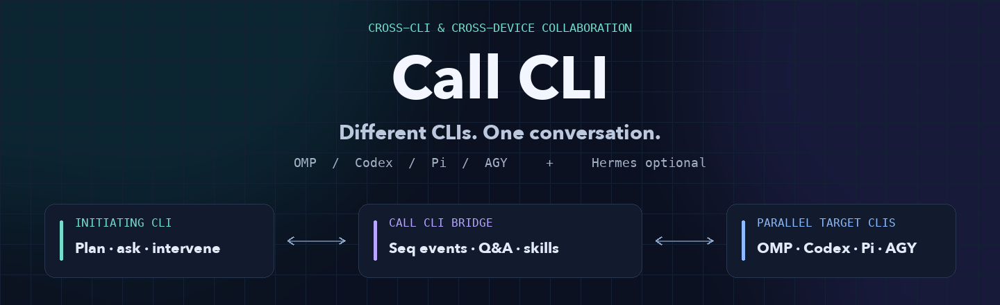
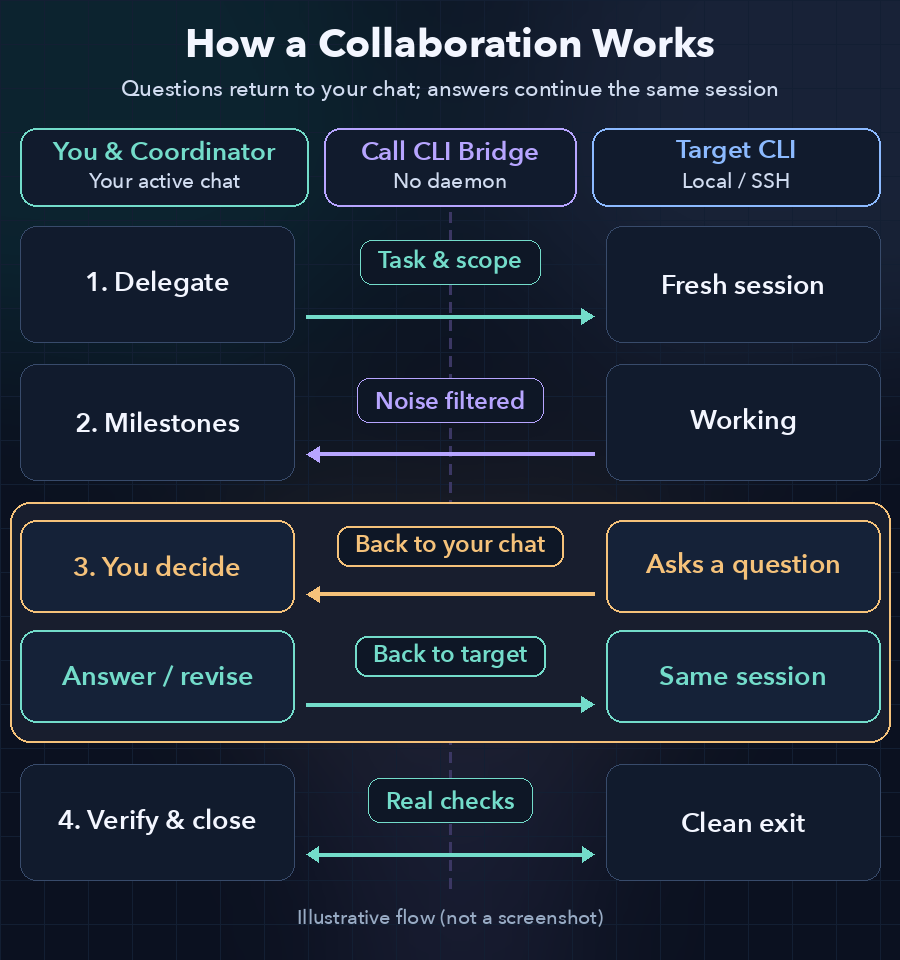
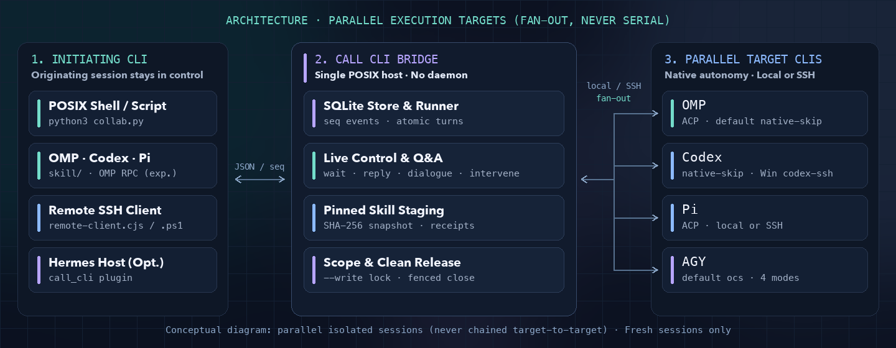

<div align="center">



**Delegate work to other coding CLIs without leaving your conversation.**

<a href="README.md"><strong>English</strong></a> · <a href="README.zh-CN.md">简体中文</a>

<a href="https://github.com/openclaw/acpx"></a>
<a href="LICENSE"></a>

[Why Call CLI](#why-call-cli) · [How It Works](#how-a-collaboration-works) · [Roles & Boundaries](#roles-and-boundaries) · [First Win](#first-win) · [OAR Roadmap](#oar-roadmap) · [Evidence & Safety](#evidence-and-safety) · [AI Setup & Manuals](#ai-setup-and-manuals)

</div>

---

<a id="why-call-cli"></a>
## Why Call CLI?

When you are already working in **Hermes** (or **OMP**, **Codex**, or **Pi**) and want another native coding CLI to take a scoped job—locally or over an existing SSH connection—the usual workflow breaks down quickly. You end up opening extra terminals, re-pasting project context, copying clarifying questions back and forth by hand, guessing whether a quiet worker is making real progress or stuck repeating tool calls, risking clobbered uncommitted edits, or mistaking a process finishing cleanly for verified completion.

Call CLI keeps your initiating CLI as the **coordinator** inside the conversation you already have. It acts as a lightweight, daemon-free POSIX **bridge** connecting that coordinator to fresh native **executors** (`OMP`, `Codex`, `Pi`, `AGY`) locally or over SSH—bringing milestones, clarifying questions, and final outputs back to your originating chat until you inspect and close the task.

**What it is not:**

- **No mandatory Hermes dependency, no always-on daemon, and no new external scheduler:** Coordination runs through a lightweight local POSIX store and short-lived CLI or host calls.
- **Fresh sessions only:** Call CLI starts new task-scoped sessions and never attaches to or takes over manually opened terminals, TUIs, or desktop GUIs.
- **Clear initiator vs. executor roles:** Initiators are **Hermes, OMP, Codex, and Pi**; **AGY is execution-only**.
- **Honest control and lock boundaries:** Controls vary by target runtime—cancelling a running turn and resuming the same session is never disguised as hot mid-turn steering, and write locks coordinate who edits a folder rather than acting as an OS or filesystem sandbox.

---

<a id="how-a-collaboration-works"></a>
## How a Collaboration Works

<div align="center">

 fresh session) -> 2 Milestones (noise filtered) -> 3 You decide (question returns to your chat; answer or revise resumes the same session) -> 4 Verify & close (real checks, clean exit)" width="100%">

</div>

*Illustrative diagram, not a live screenshot or recorded run. [Open full-resolution walkthrough diagram](docs/assets/call-cli-walkthrough.png) on mobile to zoom.*

*Illustrative scenario — not a recorded live run.* Suppose you are working in **Hermes** (or **Codex** / **OMP**) on a repository and delegate a scoped bug fix and regression test to **Codex** over SSH (or **AGY** locally) without leaving your chat:

1. **Start with clear scope (optional isolated copy):** Your coordinator starts a fresh session locally or over SSH. Ordinary folders stay ordinary, single-owner repository tasks run in place protecting existing edits, and an optional sibling Git worktree outside the repository is prepared only when parallel or isolated edits justify it (never automatically for every task).
2. **Useful progress, not chatter:** Routine tool noise is filtered out so you see real milestones, blockers, and periodic check-ins when a run stays quiet or appears stuck repeating tool calls—without rigid timeouts auto-killing active work.
3. **A concrete question returns to your conversation:**
   > **Executor asks:** *"Should invalid timestamps in older config files fail with an error, or fall back to UTC for backward compatibility?"*
   > **You answer (in the same chat):** *"Fail on new writes, keep UTC fallback for legacy imports, and add a test for both."*
   Routine in-scope questions can be answered directly by your coordinator; real decisions come to you in the same thread, and your answer returns so the **same session continues**.
4. **Course correction in flight:** Tell your coordinator in the same conversation if requirements shift mid-run. **Controls vary by target runtime:** active native AGY owners queue revisions serially, whereas standard ACPX routes cancel the current turn, wait for it to settle, and resume the same session with your revised instructions—never claiming hot mid-turn steering.
5. **Verify and close cleanly:** A finished process never substitutes for checking the work. Your coordinator inspects the real files and tests, cleanly integrates and removes any optional temporary worktree after verification (protecting unrelated user edits, or retaining it with an explicit reason), and closes the target session cleanly.

Want the exact protocol, lock, skill-snapshot, and worktree mechanics? Expand [Architecture diagram & operational details](#roles-and-boundaries) below or see [`docs/usage.md`](docs/usage.md) (简体中文).

---

<a id="roles-and-boundaries"></a>
## Coordinator vs. Bridge vs. Executor

| Role | Who runs here | What it owns | Hard boundary |
| :-- | :-- | :-- | :-- |
| **Coordinator** | `Hermes`, `OMP`, `Codex`, `Pi` (via skill, RPC, or plugin) | Holds your conversation, sets scope, answers or escalates real decisions, sends mid-run revisions, verifies files and tests, manages optional isolated worktrees, closes sessions. | Keeps final acceptance in the originating chat; AGY never acts as an initiator. |
| **Call CLI Bridge** | Lightweight POSIX bridge (no always-on daemon) | Tracks task handles and resumable progress, filters noisy tool chatter, surfaces milestones and quiet/stuck check-ins, coordinates single-writer folder locks, records receipts. | Not a background daemon or OS sandbox; read-only checks never mutate tasks or start work. |
| **Executor** | Fresh native `OMP`, `Codex`, `Pi`, `AGY` (local or over SSH) | Runs an isolated session in the target workspace, emits milestones and clarifying questions, and manages its own internal native tools and modes. | Fresh sessions only (no manual TUI/GUI takeover); a finished process never substitutes for independent verification. |

<details>
<summary><strong>Architecture diagram &amp; operational details</strong></summary>

<div align="center">



</div>

*Conceptual diagram, not a live screenshot or recorded run: one Coordinator fans out through the Call CLI Bridge to **parallel, isolated Executor sessions** (`OMP`, `Codex`, `Pi`, `AGY`) locally or over SSH. Lines never imply target-to-target chaining (nor prohibit user-authorized hierarchical coordination); Call CLI never attaches to manually opened terminals. [Open full-resolution architecture diagram](docs/assets/call-cli-architecture.png) on mobile to zoom.*

### Essential Workflows & Capabilities

- **Entries & transports ([`docs/integrations.md`](docs/integrations.md), [`CODEX_SSH.md`](CODEX_SSH.md)):** Coordinate via POSIX `collab.py` + SQLite (`seq` cursors, `?mode=ro` read-only observation), CLI `skill/` bundles, single-file Node SSH client `remote-client.cjs`, Windows PowerShell `remote-client.ps1` + desktop `codex-ssh.cjs` bridge (avoiding Node `spawn(ssh) EPERM` and Session 0 `0xC0000142`), experimental OMP RPC extension `omp-extension.mjs` (`call_cli_omp`), optional Hermes `call_cli` plugin (adding `native_continuity.py` compaction continuity and `dashboard/plugin_api.py` fixed-target release routes), or the unapplied optional silence patch [`compat/hermes-silence/README.md`](compat/hermes-silence/README.md). See [`docs/integrations.md`](docs/integrations.md) (简体中文) and its [runtime dependency closure](docs/integrations.md#运行时依赖闭包).
- **AGY native modes ([`skill/references/agy-models.md`](skill/references/agy-models.md)):** Execution-only. Defaults to **ocs** (Orchestrator Carbon `gemini-pro-orchestrator` + native Swarm); bare shorthands `oc`/`oa`/`on`/`4c`/`4a`/`4h`/`4n`/`g4c`/`g4a`/`g4h`/`g4n` run `single`, suffix `s` runs native `swarm` (including `ons` -> `gemini-pro-orchestrator-neon` and `g4hs`/`4hs` -> `gemini-4-hydrogen`), suffix `t` runs native `teamwork`, and `--agy-mode dynamic` runs `/run-workflow` (exact advertised IDs discovered via `models.cjs`, with fail-closed `session/load`, fatal sentinel detection, `AUTH_REQUIRED` projection, and single native `session/cancel`).
- **Permissions vs. single-writer locks ([`skill/references/core-requirements.md`](skill/references/core-requirements.md)):** New `OMP`, `Codex`, `Pi`, and `AGY` tasks default to `execution_policy: "native-skip"` (`skip-permissions` on AGY; `--agy-approval approve-all|approve-reads` opts back in on AGY, legacy tasks retain their policy) without modifying global CLI configs (`~/.acpx`, `~/.codex`, `~/.omp`, `~/.pi`, `~/.gemini`). `--write` / `write: false` (`--resource`) declares **task scope and single-writer locks, not an OS sandbox**; on ACPX `0.21.1`/`0.22.0`, `SharedAcpRuntime` `fs/*` callbacks stay restricted to `cwd` even under `native-skip`.
- **600s review checkpoints, optional Git/worktree & recovery ([`docs/usage.md`](docs/usage.md), [recovery contract](skill/references/core-requirements.md#写占用恢复合同)):** `events.classify_event_delivery` filters routine diagnostics, intermediate streaming `answer` chunks, and duplicate stages while `ReviewTracker` emits shared 600s `quiet_notice` review checkpoints (`notice_kind`, `substantive_progress`, `tool_churn_only`). Pure-stdlib [`git_worktree.py`](git_worktree.py) prepares outside-repo sibling worktrees on demand (failing closed rather than falling back to the main checkout), inspects four independent delivery states (`uncommitted_files`, `branch_commits`, `integrated`, `verified`), converges without `git stash`/`reset`/`clean`/`--force`, and removes the worktree after verified integration (or reports `retained_with_reason`). Observation actions (`list`, `status`, `events`, `recovery_status`) stay pure read-only (`?mode=ro`); `unknown`/HOLD tasks reconcile via `close`/`reconcile` probes or explicit `release_only` (`--abandon` when risk-accepted).
- **Task-pinned skills & pluggable backends ([`skill/references/skill-passing.md`](skill/references/skill-passing.md), [`docs/integrations.md#后端扩展接口`](docs/integrations.md#后端扩展接口)):** Stage `required`/`optional`/`reference` skill bundles (`--skill`, `--target-skill`, `--skills-json`) via immutable SHA-256 snapshots and per-turn `CALLCLI_SKILL` receipts. Backends register through `backends.py`; see [`VERIFICATION.md#current-acceptance-index`](VERIFICATION.md#current-acceptance-index) for acceptance scope.

</details>

---

<a id="first-win"></a>
## First Win: Local Smoke Check (No Model or Credentials)

Verify the coordinator core locally using only POSIX Python 3.9+ with `fcntl` (standard library only; macOS verified; Windows is supported as a remote client or execution device, not the POSIX coordinator host):

```sh
git clone https://github.com/Loveacup/call-cli.git && cd call-cli

(
  set -eu
  CALL_CLI_DB="$(mktemp "${TMPDIR:-/tmp}/call-cli-first-win.XXXXXX")"
  trap 'rm -f "$CALL_CLI_DB"' EXIT
  CLIENT_JSON="$(python3 collab.py --db "$CALL_CLI_DB" connect --runtime omp)"
  printf '%s\n' "$CLIENT_JSON"
  CLIENT_ID="$(printf '%s' "$CLIENT_JSON" | python3 -c 'import json,sys; print(json.load(sys.stdin)["client_id"])')"
  python3 collab.py --db "$CALL_CLI_DB" --client "$CLIENT_ID" list
)
```

- **Observable success:** `connect` prints JSON with a UUID `client_id` and `"declared_runtime": "omp"`; `list` exits `0` and prints `[]`; the subshell `trap` removes `"$CALL_CLI_DB"` on exit while keeping any command failure visible; zero background daemons or services were created.
- **Next step:** Jump to [AI Setup, Deployment Prerequisites & Agent Manuals](#ai-setup-and-manuals) to let your existing AI configure your workflow or walk through a full live read-only collaboration.

---

<a id="oar-roadmap"></a>
## OAR Roadmap

We are preparing to move Call CLI's **execution layer** toward [Open Agent Runtime (OAR)](https://github.com/botiverse/oar) so coordinators get clearer visibility into live execution and can change direction mid-turn where the underlying runtime supports it without cancelling and restarting the turn—while the initiating CLI (such as Hermes, OMP, Codex, or Pi) retains task ownership, conversation return, and final acceptance.

**Today:** OAR is an experimental opt-in via `collab.py start --backend oar` for **new local single-agent AGY tasks only** (requires `CALL_CLI_OAR_DIST` pointing to a `@botiverse/oar` package root containing `dist/`, verified with fixture `0.121.0` on Node.js 24+). There is **no default migration**—ACPX routes and AGY native Swarm, Teamwork, and Dynamic remain unchanged—and **Hermes and OMP host tools do not expose this switch**. See [`docs/usage.md`](docs/usage.md) (简体中文) and [`ROADMAP.md`](ROADMAP.md) (简体中文) for prerequisites and scope.

---

<a id="evidence-and-safety"></a>
## Evidence, Verification & Safety

- **Evidence layers are strictly separated:** Published source snapshots, offline unit/fixture suites, synthetic ACPX/AGY protocol probes, sampled real-model runs, and real host/Telegram delivery are reported independently without inferring one from another—see [`VERIFICATION.md`](VERIFICATION.md), [`docs/publication-2026-11-18.md`](docs/publication-2026-11-18.md), and [`docs/publication-2026-11-16.md`](docs/publication-2026-11-16.md).
- **Trust & safety boundaries:** Call CLI is a single-user coordination tool, not a multi-tenant service or OS sandbox; `client_id` handles are local capabilities, `unknown` turns retain write locks for reconciliation instead of auto-replaying, and SSH/target CLIs run as the configured OS user—see [`SECURITY.md`](SECURITY.md).
- **Version checks are not auto-upgrades:** Each logical new task checks `acpx --version` and `npm view acpx dist-tags.latest` once on the execution device; normal dispatch never installs or upgrades packages (`updates.py` upgrades require separate authorization and an idle device lock).

<details>
<summary><strong>Offline verification commands &amp; detailed evidence boundaries</strong></summary>

| Layer | Verified scope | Explicit boundary / not claimed |
| :-- | :-- | :-- |
| **Published source & offline checks** | 2026-11-15 public source check: 241 Python tests (including inherited/repeated unittest counts), Node 99/101 (2 opt-in native SDK tests skipped), `node test_release_backend.cjs` printing `STRICT_NATIVE_RELEASE_PROOF_OK`. Prior complete offline baseline: 357 Python discovered (345 passed, 12 skipped) and 6-file Node 81 passed; OCS 141 and Teamwork 9/9 incremental checks are indexed in [`VERIFICATION.md`](VERIFICATION.md). | Different source snapshots and scopes cannot be added together; offline fixtures and synthetic transports do **not** prove live-model behavior, real Windows PowerShell runs, GitHub Actions CI, or deployed-host acceptance. |
| **Native ACPX & AGY probes (`RUN_NATIVE_ACPX_TESTS=1`)** | Opt-in `test_native_shared`, `test_native_skills`, and `test_native_release` against ACPX 0.22.0 + synthetic ACP endpoints, plus AGY `session/load` and zero-prompt model readback (`test_agy_native_owner.py`). | Bounded probes against synthetic endpoints—not universal multi-turn or active-tool cancellation LLM compliance. |
| **Sampled live runs** | Sampled macOS/Windows SSH runs and AGY native samples indexed in [`VERIFICATION.md`](VERIFICATION.md). | Sampled targets/models only; active-tool hot cancel, arbitrary detached-descendant stop proof, and real-host Teamwork E2E remain unverified. |
| **Host adapters & silence patch** | Optional Hermes plugin (`__init__.py`), OMP RPC extension (`omp-extension.mjs`), and unapplied `compat/hermes-silence/` (`138` passed in 5-file gateway suite via `compat/hermes-silence/run_tests.py`). | Updated schemas require a host refresh or new session; source checks do not prove universal current-chat consumption, live gateway patch reload, Telegram E2E delivery, upstream AGY error wording, or offline idle wakeup. |

```sh
# Standard offline verification suites (no model credentials or network required)
python3 -B -m unittest discover -v
node --test test_skill_stage.cjs test_shared_prompt.cjs test_models.cjs test_codex_ssh.cjs test_omp_extension.mjs test_control_identity.cjs
node test_release_backend.cjs

# Optional: local ACPX queue-owner + synthetic ACP endpoints (no live LLM calls)
RUN_NATIVE_ACPX_TESTS=1 python3 -B -m unittest test_native_skills test_native_shared test_native_release -v
```

**Scope & safety pre-access checklist:**

- **Fresh sessions only:** Never attaches to manually opened terminals, TUIs, or GUIs.
- **Not OS sandboxes:** New tasks default to `native-skip` (`skip-permissions` on AGY; `--agy-approval approve-all|approve-reads` opts back in on AGY; legacy tasks keep their policy). Neither `write: false` nor SQL release fences isolate the OS filesystem or prove detached descendants stopped; `--write` locks and global CLI configs (`~/.acpx`, `~/.codex`, `~/.omp`, `~/.pi`, `~/.gemini`) remain untouched.
- **ACPX `fs/*` `cwd` limit:** On ACPX `0.21.1`/`0.22.0`, `fs/*` callbacks stay inside `cwd` even under `native-skip`; cross-directory skill reads rely on target-CLI native file tools.
- **Reconcile & private state:** Never auto-replay `unknown` outcomes (`close`/`reconcile` probes first, or explicit `release_only`). Keep SQLite DBs, `client_id` handles, `release-policy.json`, and credentials private under one POSIX coordinator.

</details>

---

<a id="ai-setup-and-manuals"></a>
## AI Setup, Deployment Prerequisites & Agent Manuals

<details>
<summary><strong>Copyable AI setup prompt (OMP / Codex / Pi / Hermes)</strong></summary>

Paste this prompt into the OMP, Codex, Pi, or Hermes session you already use:

```text
Read README.md and docs/configuration.md in https://github.com/Loveacup/call-cli,
then inspect collab.py and docs/integrations.md to set up Call CLI for this CLI.

1. Discover first (read-only): check python3, node, npm, acpx, existing Call CLI
   checkouts, SSH aliases, skill directories and target CLI logins before asking
   for missing values. Preserve existing files, configurations and credentials.
2. Prepare only what I need: install only the entry, skill or optional Hermes
   module required for my workflow. Do not create an always-on service or daemon,
   and do not auto-apply upstream compatibility patches. Explain the once-per-task
   npm version check before starting work; package upgrades require separate
   authorization on an idle device.
3. Verify safely and distinguish boundaries: run a local no-model check
   (connect + list) first. Obtain approval before launching a real read-only
   collaboration or external effects, close owned test sessions (confirming
   released/no-session), and report source checks, host compatibility and real
   end-to-end results separately.
```

The linked [AI setup guide (`docs/configuration.md`, 简体中文)](docs/configuration.md) is **an execution manual written for your AI agent**, not a questionnaire for humans to fill out by hand. Detailed operational manuals are maintained in **Simplified Chinese**; both README editions cover identical commands, flags, and boundaries.

</details>

<details>
<summary><strong>Host activation prerequisites, entry matrix &amp; live read-only walkthrough</strong></summary>

### Host Activation Prerequisites

- **Coordinator host:** POSIX Python 3.9+ with `fcntl` (stdlib only; macOS verified; Windows supported as remote client or execution device, not POSIX coordinator).
- **Live execution runtime (ACPX path):** Node.js `>=22.13.0`, npm, globally resolvable ACPX exposing `acpx/runtime` (live runs verified on `0.22.0`; Windows SSH OMP on `0.21.1`; baseline `0.20.0`), and natively logged-in target CLIs (`omp`, `codex`, `pi`, `agy`).
- **Experimental OAR path (opt-in only):** `--backend oar` for new local single-agent AGY tasks only (`CALL_CLI_OAR_DIST` pointing to `@botiverse/oar` with `dist/`, verified with fixture `0.121.0` on Node.js `24+`).
- **Host schema & patch boundaries:** Updated Hermes or OMP tool schemas require a host refresh or a new session (running sessions retain earlier tool snapshots). The optional unapplied `compat/hermes-silence` patch is pinned solely to `NousResearch/hermes-agent` commit `2bd378ed1b8d6bf2192cb26e0a55ff3091e6bd19` and gated by read-only `check.py`.
- **AGY native shorthands & Hermes gateway reload boundary (`backends.py`):**
  1. **Checked-in AGY shorthands (`_AGY_ALIASES` / `prepare_start`):** `ons` selects **Neon native Swarm** (`model="gemini-pro-orchestrator-neon"`, `agy_swarm="native"`, `agy_mode="swarm"`) and `g4hs` selects **Hydrogen native Swarm** (`model="gemini-4-hydrogen"`, `agy_swarm="native"`, `agy_mode="swarm"`, alongside `4hs` and the `oc`/`oa`/`on`/`4c`/`4a`/`4h`/`4n`/`g4c`/`g4a`/`g4h`/`g4n` shorthand grammar where bare=`single`, suffix `s`=native `swarm`, suffix `t`=native `teamwork`). The default **`ocs`** (`gemini-pro-orchestrator` + native Swarm when `model` is omitted) remains unchanged.
  2. **Stale long-lived Hermes gateway after plugin update:** Updating files on disk, opening a new terminal shell, or succeeding with an explicit complete model ID does **not** prove a long-lived Hermes gateway process has refreshed its loaded `call_cli` plugin module or tool schema.
  3. **Supported refresh & verification:** Perform a supported host reload during an idle maintenance window, then verify that a literal alias (`model="ons"` or `model="g4hs"`) resolves and submits the expected target `model` (`gemini-pro-orchestrator-neon` or `gemini-4-hydrogen`) and mode (`agy_swarm="native"`, `agy_mode="swarm"`).
  4. **Temporary workaround before host reload:** Pass the Neon model ID `gemini-pro-orchestrator-neon` or the Hydrogen family selector `gemini-4-hydrogen`, and explicitly request native Swarm (`agy_mode="swarm"` or `agy_swarm="native"`). Call CLI does not silently switch models or replay failed tasks.

### Entry Matrix

| Entry | Target / invocation | Control, return flow & boundary |
| :-- | :-- | :-- |
| **POSIX shell / script** | `python3 collab.py` | Actions: `connect`, `start`, `list`, `status`, `events`, `wait`, `reply`, `dialogue`, `permission`, `intervene`, `cancel`, `close`, `release_only`, `recovery_status`. `list`/`status`/`events`/`recovery_status` are pure read-only (`?mode=ro`); bounded `wait` or same-`command_id` `intervene` retry advances settled interventions. `connect --runtime` declares a local handle, not native host identity. |
| **OMP, Codex or Pi** | `skill/` bundle + entry | Guides discovery, `seq` polling, Q&A, `cancel+resume`, and skill passing; does not install dependencies or replace target CLI logins. |
| **OMP RPC host (exp.)** | `omp --mode rpc --no-ui --no-extensions -e /absolute/call-cli/omp-extension.mjs` | Single load in a new owned RPC instance (`call_cli_omp`, omitting `reconcile`; includes pure-read `recovery_status(task_id)`). Native `ctx` binds identity; pre-bind `list`/`recovery_status` use read-only observation without persistent `bind`/DB writes; observation never starts or alters 1s `wait` polling, which activates only on `start`/control actions and queues `followUp`. Exit stops delivery only; TUI, ACP defer, and restart recovery remain unverified. |
| **SSH remote client** | `remote-client.cjs` | Single-file Node SSH client forwarding single-shot JSON actions to `collab.py` on the POSIX coordinator host. |
| **Windows Codex** | `remote-client.ps1` / `codex-ssh.cjs` | `remote-client.ps1` avoids Node `spawn(ssh) EPERM` in the Windows Codex sandbox (verified with macOS coordinator); `codex-ssh.cjs` launches desktop-context Codex via InteractiveToken to avoid Session 0 `0xC0000142`. |
| **Hermes plugin (opt.)** | `call_cli` (`__init__.py`, `plugin.yaml`) | Binds `HERMES_SESSION_*` origin, runs background tasks, keeps `list`/`status`/`events`/`recovery_status` pure read-only (`?mode=ro`, zero implicit advance/launch), and adds `reconcile`, `release_only`, `recovery_status`, compaction continuity (`native_continuity.py`), `local_toolchain_bin`, and operator release routes (`dashboard/plugin_api.py`). Schema updates require host refresh or a new session. |
| **Hermes silence patch** | [`compat/hermes-silence/`](compat/hermes-silence/README.md) | **Independent, optional, and never auto-applied.** Pinned to `NousResearch/hermes-agent` `2bd378ed1b8d6bf2192cb26e0a55ff3091e6bd19` with read-only `check.py` gate; requires manual apply/rollback on an idle clean checkout. |

### Continuous Live Read-Only Collaboration Example

Run inside an approved checkout (`CALL_CLI_HOME="$PWD"`) with Node.js, ACPX, and logged-in `omp` / `agy`:

```sh
CALL_CLI_HOME="$PWD"
CALL_CLI_DB="$(mktemp "${TMPDIR:-/tmp}/call-cli-live.XXXXXX")"
CLIENT_JSON="$(python3 "$CALL_CLI_HOME/collab.py" --db "$CALL_CLI_DB" connect --runtime omp)"
CLIENT_ID="$(printf '%s' "$CLIENT_JSON" | python3 -c 'import json,sys; print(json.load(sys.stdin)["client_id"])')"

# 1. Start a read-only OMP task and wait with resumable seq cursor
TASK_JSON="$(python3 "$CALL_CLI_HOME/collab.py" --db "$CALL_CLI_DB" --client "$CLIENT_ID" \
  start --device local --agent omp --cwd "$CALL_CLI_HOME" \
  --prompt 'Read collab.py and summarize the CLI subcommands in 3 bullet points. Do not modify files.')"
TASK_ID="$(printf '%s' "$TASK_JSON" | python3 -c 'import json,sys; print(json.load(sys.stdin)["id"])')"

WAIT_JSON="$(python3 "$CALL_CLI_HOME/collab.py" --db "$CALL_CLI_DB" --client "$CLIENT_ID" wait --task "$TASK_ID" --after 0 --timeout 5)"
AFTER="$(printf '%s' "$WAIT_JSON" | python3 -c 'import json,sys; print(json.load(sys.stdin)["after"])')"

# Repeat wait --after "$AFTER" updating WAIT_JSON/AFTER until task.state settles.
# If task.state == "waiting_reply", extract exact question_id and reply:
# QUESTION_ID="$(printf '%s' "$WAIT_JSON" | python3 -c 'import json,sys; print(json.load(sys.stdin)["task"]["question_id"])')"
# python3 "$CALL_CLI_HOME/collab.py" --db "$CALL_CLI_DB" --client "$CLIENT_ID" reply --task "$TASK_ID" --question-id "$QUESTION_ID" --prompt 'Your answer here'

# Inspect results first; only close after settlement is verified:
python3 "$CALL_CLI_HOME/collab.py" --db "$CALL_CLI_DB" --client "$CLIENT_ID" close --task "$TASK_ID"

# 2. Separate read-only AGY example with live model discovery & task-pinned skill
node "$CALL_CLI_HOME/models.cjs" "$CALL_CLI_HOME"
MODEL_ID="gemini-4-argon"  # replace with an exact availableModelIds value from models.cjs
AGY_TASK_JSON="$(python3 "$CALL_CLI_HOME/collab.py" --db "$CALL_CLI_DB" --client "$CLIENT_ID" \
  start --device local --agent agy --agy-swarm off --agy-approval approve-reads --model "$MODEL_ID" \
  --cwd "$CALL_CLI_HOME" --skill reference="$CALL_CLI_HOME/skill" \
  --prompt 'Read the passed skill as reference and list the supported actions. Do not modify files.')"
AGY_TASK_ID="$(printf '%s' "$AGY_TASK_JSON" | python3 -c 'import json,sys; print(json.load(sys.stdin)["id"])')"

AGY_WAIT_JSON="$(python3 "$CALL_CLI_HOME/collab.py" --db "$CALL_CLI_DB" --client "$CLIENT_ID" wait --task "$AGY_TASK_ID" --after 0 --timeout 5)"
AGY_AFTER="$(printf '%s' "$AGY_WAIT_JSON" | python3 -c 'import json,sys; print(json.load(sys.stdin)["after"])')"
# Repeat wait --after "$AGY_AFTER" updating AGY_WAIT_JSON/AGY_AFTER until settled; review output, then close:
python3 "$CALL_CLI_HOME/collab.py" --db "$CALL_CLI_DB" --client "$CLIENT_ID" close --task "$AGY_TASK_ID"

# Confirm all owned tasks are closed before removing the DB:
python3 "$CALL_CLI_HOME/collab.py" --db "$CALL_CLI_DB" --client "$CLIENT_ID" list
# After confirming list shows all tasks closed: rm -f "$CALL_CLI_DB"
```

</details>

<details>
<summary><strong>Agent operational manuals &amp; reference index</strong></summary>

| Guide | Covers | Language |
| :-- | :-- | :-- |
| [`docs/configuration.md`](docs/configuration.md) | Environment scan, SSH aliases, ACPX setup, auth, permissions, and acceptance. | 简体中文 |
| [`docs/integrations.md`](docs/integrations.md) | Skill install, OMP RPC, Hermes plugin, recovery, `backends.py`, and runtime closure. | 简体中文 |
| [`docs/usage.md`](docs/usage.md) | `seq` polling, `CALLCLI_QUESTION`, `reply`, `dialogue`, `intervene`, 600s checkpoints, `--clear-timeout`, `close`, `release_only`, `git_worktree.py`, and OAR opt-in. | 简体中文 |
| [`skill/SKILL.md`](skill/SKILL.md) | Core cross-CLI coordination skill entrypoint for OMP, Codex, Pi, and Hermes. | 简体中文 |
| [`skill/references/core-requirements.md`](skill/references/core-requirements.md) | Canonical contract: bidirectional flow, AGY thin bridges, `native-skip`, recovery, worktrees, and evidence layers. | 简体中文 |
| [`skill/references/skill-passing.md`](skill/references/skill-passing.md) | Local-first discovery, repo signals, `required`/`optional`/`reference` modes, and `CALLCLI_SKILL`. | 简体中文 |
| [`skill/references/agy-models.md`](skill/references/agy-models.md) | Default `ocs`, shorthands, exact IDs, single-owner settlement, and boundaries. | 简体中文 |
| [`skill/references/hermes-host.md`](skill/references/hermes-host.md) | Origin capture, compaction continuity, ended-owner recovery, and `[SILENT]` guidance. | 简体中文 |
| [`skill/references/maintenance.md`](skill/references/maintenance.md) | Once-per-task source/install checks and idle-only ACPX maintenance. | 简体中文 |
| [`skill/references/online-collab.md`](skill/references/online-collab.md) | Generic online coordination workflow, bounded polling, and control semantics. | 简体中文 |
| [`skill/references/coordination.md`](skill/references/coordination.md) | Lifecycle ownership, rework, late notices, and stage review guidance. | 简体中文 |
| [`skill/references/native-commands.md`](skill/references/native-commands.md) | ACPX native commands, SSH/encoding notes, watch, cancellation, and diagnostics. | 简体中文 |
| [`skill/references/protocol-decoding.md`](skill/references/protocol-decoding.md) | ACP decoding, callback recovery, and turn settlement rules. | 简体中文 |
| [`skill/references/deployment.md`](skill/references/deployment.md) | Publication checks, three-device deployment, and rollback order. | 简体中文 |
| [`skill/references/devices.md`](skill/references/devices.md) | Local device inventory template convention (no maintainer device bindings). | 简体中文 |
| [`skill/references/verification.md`](skill/references/verification.md) | Per-layer verification boundaries across models, adapters, and hosts. | 简体中文 |
| [`skill/references/windows-codex-ssh.md`](skill/references/windows-codex-ssh.md) | Windows Codex SSH window-station (`0xC0000142`) and sandbox startup boundaries. | 简体中文 |
| [`CODEX_SSH.md`](CODEX_SSH.md) | Desktop `codex-ssh.cjs` bridge and native PowerShell client (`remote-client.ps1`). | 简体中文 |
| [`compat/hermes-silence/README.md`](compat/hermes-silence/README.md) | Unapplied silence patch on `NousResearch/hermes-agent` `2bd378ed1b8d6bf2192cb26e0a55ff3091e6bd19`, `check.py`, rollback, and tests. | English |
| [`docs/publication-2026-11-18.md`](docs/publication-2026-11-18.md) | Observation/control R2 publication parity and verification boundaries. | English |
| [`docs/publication-2026-11-16.md`](docs/publication-2026-11-16.md) | Reviewed deployed-source publication closure and exclusions. | English |
| [`VERIFICATION.md`](VERIFICATION.md) | Complete historical and current verification index. | English |
| [`ROADMAP.md`](ROADMAP.md) | Current goals, OAR direction, and out-of-scope boundaries. | 简体中文 |
| [`SECURITY.md`](SECURITY.md) | Trust boundaries and private vulnerability reporting. | English |

</details>

---

## Project Links, Artwork Note & Acknowledgements

- **Project documents:** [Verification (`VERIFICATION.md`, English)](VERIFICATION.md) · [Roadmap (`ROADMAP.md`, 简体中文)](ROADMAP.md) · [Security (`SECURITY.md`, English)](SECURITY.md) · [Contributing (`CONTRIBUTING.md`, English)](CONTRIBUTING.md) · [License (`LICENSE`)](LICENSE)
- **Artwork note:** [`docs/assets/render_banner.py`](docs/assets/render_banner.py) uses Pillow solely for regenerating the diagram PNGs; Pillow is not a runtime or test dependency.
- **Acknowledgements:** Built on [ACPX](https://github.com/openclaw/acpx) and the native capabilities of OMP, Codex, Pi, AGY, and Hermes. Call CLI is an independent project and is not affiliated with those upstream tools.

<div align="center">

**Different tools. Shared direction.**

[MIT License](LICENSE) · [简体中文](README.zh-CN.md)

</div>
