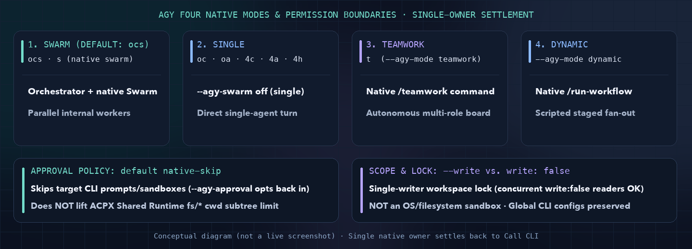

<div align="center">


**Give your CLI a teammate, not just another subprocess.**

<a href="README.md"><strong>English</strong></a> · <a href="README.zh-CN.md">简体中文</a>

<a href="https://github.com/openclaw/acpx"></a>
<a href="LICENSE"></a>

[Quick start](#quick-start) · [Choose your entry](#choose-your-entry) · [Core capabilities](#capabilities) · [Architecture & lifecycle](#how-it-works) · [Evidence & boundaries](#evidence-and-boundaries) · [Documentation](#documentation)

</div>

---

Call CLI is a lightweight POSIX coordination bridge connecting **OMP, Codex, Pi and AGY** (with optional Hermes host integration), **locally or over existing SSH connections**. The **initiating CLI coordinates** fresh target sessions, receives **progress, numbered questions and results back in the originating session**, sends **mid-run adjustments** (`dialogue` or explicit `cancel+resume` `intervene`) in flight, and runs **independent acceptance and cleanup (`close`)**—while letting each target CLI exercise **native autonomy internally without a second task platform or always-on daemon**.

**What it is not:** No mandatory Hermes dependency, always-on daemon or scheduler. No hot `steer` disguised as lossless editing. No takeover of manually opened terminal, TUI or desktop GUI sessions. Initiators are **OMP, Codex, Pi and Hermes**; **AGY is execution-only**.

## Why Call CLI?

| | Capability | What you get |
| :-- | :-- | :-- |
| 🔄 | **Origin-bound return flow** | Follow resumable `seq` stage progress, questions and final results in your initiating session, with shared 600s review checkpoints instead of rigid timeouts. |
| 🧭 | **Live control (`reply` / `dialogue` / `intervene`)** | Answer ACPX questions via `reply`, queue serial `dialogue` on active AGY owners, or redirect via `intervene` (`cancel+resume`, never in-turn `steer`). |
| 🤖 | **First-class AGY & four native modes** | Defaults to **ocs** (Orchestrator Carbon + Swarm); supports `single`, `swarm`, `teamwork` and `--agy-mode dynamic` (`/run-workflow`) with native internal autonomy. |
| 🛡️ | **`native-skip` & single-writer locks** | New tasks default to `native-skip` (`skip-permissions` on AGY) without touching global CLI configs, while enforcing `--write` single-writer workspace locks. |
| 📦 | **Task-pinned skill passing** | Stage local or target-side skills (`required`, `optional`, `reference`) via immutable SHA-256 task snapshots and per-turn `CALLCLI_SKILL` receipts. |
| 🔌 | **Flexible entries & host bridges** | Coordinate via POSIX shell, SSH clients, CLI skills, experimental OMP RPC extension, optional Hermes plugin or an unapplied Hermes silence patch. |

<a id="quick-start"></a>
## Quick start

### Option 1: Ask your AI to set it up (Recommended)

<details>
<summary><strong>Click to expand: copyable AI setup prompt &amp; agent instructions (OMP / Codex / Pi / Hermes)</strong></summary>

Paste this prompt into the OMP, Codex, Pi or Hermes session you already use:

```text
Read README.md and docs/configuration.md in https://github.com/Loveacup/call-cli,
then inspect collab.py and docs/integrations.md to set up Call CLI for this CLI.

1. Discover first (read-only): check python3, node, npm, acpx, existing Call CLI
   checkouts, SSH aliases, skill directories and target CLI logins before asking
   for missing values. Preserve existing files, configurations and credentials.
2. Prepare only what I need: install only the entry, skill or optional Hermes
   module required for my workflow. Do not create an always-on service or daemon,
   and do not auto-apply upstream compatibility patches. Explain the once-per-task
   npm version check before starting work; package upgrades require separate
   authorization on an idle device.
3. Verify safely and distinguish boundaries: run a local no-model check
   (connect + list) first. Obtain approval before launching a real read-only
   collaboration or external effects, close owned test sessions (confirming
   released/no-session), and report source checks, host compatibility and real
   end-to-end results separately.
```

The linked [AI setup guide (`docs/configuration.md`, 简体中文)](docs/configuration.md) is **an execution manual written for your AI agent**, not a hand-filled questionnaire. Detailed AI manuals are maintained in **Simplified Chinese**; both README editions cover identical commands, parameters and boundaries.

</details>

### Option 2: Run directly from a POSIX terminal (continuous path)

- **Prerequisites:** POSIX Python 3.9+ with `fcntl` (stdlib only) on the coordinator host (macOS verified; Windows supported as client/execution device, not coordinator). For Stage B live runs: Node.js (>=22.13.0), npm, ACPX exposing `acpx/runtime` (live runs verified on **0.22.0**; Windows SSH OMP on **0.21.1**; baseline **0.20.0**), and natively logged-in target CLIs (`omp`, `codex`, `pi`, `agy`).

#### Stage A: Local coordinator smoke (no target model or credentials)

```sh
git clone https://github.com/Loveacup/call-cli.git
cd call-cli
python3 collab.py --help && python3 collab.py start --help

CALL_CLI_HOME="$PWD"
CALL_CLI_DB="$(mktemp "${TMPDIR:-/tmp}/call-cli-quickstart.XXXXXX")"
CLIENT_JSON="$(python3 "$CALL_CLI_HOME/collab.py" --db "$CALL_CLI_DB" connect --runtime omp)"
CLIENT_ID="$(printf '%s' "$CLIENT_JSON" | python3 -c 'import json,sys; print(json.load(sys.stdin)["client_id"])')"
python3 "$CALL_CLI_HOME/collab.py" --db "$CALL_CLI_DB" --client "$CLIENT_ID" list
```

- **Success:** `connect` returns UUID `client_id` (`"declared_runtime": "omp"`); `list` exits `0` with `[]`. Remove `"$CALL_CLI_DB"` if stopping here.

#### Stage B: Real read-only collaboration (same shell, reusing `CALL_CLI_HOME`, `CALL_CLI_DB`, `CLIENT_ID`)

```sh
acpx --version
TASK_JSON="$(python3 "$CALL_CLI_HOME/collab.py" --db "$CALL_CLI_DB" --client "$CLIENT_ID" \
  start --device local --agent omp --cwd "$CALL_CLI_HOME" \
  --prompt 'Read collab.py and summarize the CLI subcommands in 3 bullet points. Do not modify files.')"
TASK_ID="$(printf '%s' "$TASK_JSON" | python3 -c 'import json,sys; print(json.load(sys.stdin)["id"])')"

WAIT_JSON="$(python3 "$CALL_CLI_HOME/collab.py" --db "$CALL_CLI_DB" --client "$CLIENT_ID" wait --task "$TASK_ID" --after 0 --timeout 5)"
AFTER="$(printf '%s' "$WAIT_JSON" | python3 -c 'import json,sys; print(json.load(sys.stdin)["after"])')"
```

- **Follow-through:** Repeat the `wait` command above with `--after "$AFTER"`, updating `WAIT_JSON` and `AFTER` each time. If `task.state` is `waiting_reply`, extract the pending ID and answer it; then continue waiting. `intervene` is an explicit `cancel+resume`, not hot steering. Inspect failures or `unknown` rather than blindly retrying or closing.
  ```sh
  QUESTION_ID="$(printf '%s' "$WAIT_JSON" | python3 -c 'import json,sys; print(json.load(sys.stdin)["task"]["question_id"])')"
  python3 "$CALL_CLI_HOME/collab.py" --db "$CALL_CLI_DB" --client "$CLIENT_ID" reply --task "$TASK_ID" --question-id "$QUESTION_ID" --prompt 'Your answer here'
  ```
- **Close the OMP task:** Only after it has settled and its result is reviewed (success: `completed` and `exit_code == 0`), close it and inspect the result and list. Do not close a task merely because one wait returned.
  ```sh
  python3 "$CALL_CLI_HOME/collab.py" --db "$CALL_CLI_DB" --client "$CLIENT_ID" close --task "$TASK_ID"
  python3 "$CALL_CLI_HOME/collab.py" --db "$CALL_CLI_DB" --client "$CLIENT_ID" list
  ```
- **AGY & task skill example:** Omitting `--write` (`write: false`) is a **task scope and single-writer lock declaration—not an OS or CLI sandbox**; default `native-skip` skips target CLI interactive approvals without lifting ACPX Shared Runtime's `fs/*` `cwd` restriction. Pass `--agy-approval approve-reads` when explicit read-only denial is needed on AGY:
  ```sh
  node "$CALL_CLI_HOME/models.cjs" "$CALL_CLI_HOME"
  MODEL_ID="gemini-4-argon"  # replace with an exact availableModelIds value from models.cjs
  AGY_TASK_JSON="$(python3 "$CALL_CLI_HOME/collab.py" --db "$CALL_CLI_DB" --client "$CLIENT_ID" \
    start --device local --agent agy --agy-swarm off --agy-approval approve-reads --model "$MODEL_ID" \
    --cwd "$CALL_CLI_HOME" --skill reference="$CALL_CLI_HOME/skill" \
    --prompt 'Read the passed skill as reference and list the supported actions. Do not modify files.')"
  AGY_TASK_ID="$(printf '%s' "$AGY_TASK_JSON" | python3 -c 'import json,sys; print(json.load(sys.stdin)["id"])')"
  AGY_WAIT_JSON="$(python3 "$CALL_CLI_HOME/collab.py" --db "$CALL_CLI_DB" --client "$CLIENT_ID" wait --task "$AGY_TASK_ID" --after 0 --timeout 5)"
  AGY_AFTER="$(printf '%s' "$AGY_WAIT_JSON" | python3 -c 'import json,sys; print(json.load(sys.stdin)["after"])')"
  # Repeat wait --after "$AGY_AFTER" and update AGY_WAIT_JSON/AGY_AFTER until settled; review, then close:
  python3 "$CALL_CLI_HOME/collab.py" --db "$CALL_CLI_DB" --client "$CLIENT_ID" close --task "$AGY_TASK_ID"
  python3 "$CALL_CLI_HOME/collab.py" --db "$CALL_CLI_DB" --client "$CLIENT_ID" list
  ```
- **Cleanup:** `close` verifies local closed-record readback, scoped `no-session` (or native owner unload) and skill-snapshot cleanup; on `unknown` tasks, `close` probes read-only and explicit `release_only` (`--abandon` if risk-accepted) recovers inactive locks. Confirm all tasks are `closed` before removing `"$CALL_CLI_DB"`.

> [!NOTE]
> **Version checks are not upgrades:** Each logical new task checks `acpx --version` and `npm view acpx dist-tags.latest` once; normal dispatch never installs packages (`updates.py` upgrades require separate authorization and an idle device lock).

<a id="choose-your-entry"></a>
## Choose your entry

| Entry | Target / invocation | Control, return flow & boundary |
| :-- | :-- | :-- |
| **POSIX shell / script** | `python3 collab.py` | Actions: `connect`, `start`, `list`, `status`, `events`, `wait`, `reply`, `dialogue`, `permission`, `intervene`, `cancel`, `close`, `release_only`. Caller polls bounded `wait`/`events`; `connect --runtime` declares a local handle, not native host identity. |
| **OMP, Codex or Pi** | `skill/` bundle + entry | Guides discovery, `seq` polling, Q&A, `cancel+resume` and skill passing; does not install dependencies or replace target CLI logins. |
| **OMP RPC host (exp.)** | `omp --mode rpc --no-ui --no-extensions -e /absolute/call-cli/omp-extension.mjs` | Single load in a new owned RPC instance (`call_cli_omp`, omitting `reconcile`/`recovery_status`). Native `ctx` binds identity; 1s `wait` polling queues `followUp`. Exit stops delivery only; TUI, ACP defer and restart recovery remain unverified. |
| **SSH remote client** | `remote-client.cjs` | Single-file Node SSH client forwarding single-shot JSON actions to `collab.py` on the POSIX coordinator host. |
| **Windows Codex** | `remote-client.ps1` / `codex-ssh.cjs` | `remote-client.ps1` avoids Node `spawn(ssh) EPERM` in the Windows Codex sandbox (verified with macOS coordinator); `codex-ssh.cjs` launches desktop-context Codex via InteractiveToken to avoid Session 0 `0xC0000142`. |
| **Hermes plugin (opt.)** | `call_cli` (`__init__.py`, `plugin.yaml`) | Binds `HERMES_SESSION_*` origin, runs background tasks, advances authorized `intervene` on `status`/`events`, and adds `reconcile`, `release_only`, `recovery_status`, compaction continuity (`native_continuity.py`), `local_toolchain_bin` and operator release routes (`dashboard/plugin_api.py`). Schema updates require host refresh or a new session. |
| **Hermes silence patch** | [`compat/hermes-silence/`](compat/hermes-silence/README.md) | **Independent, optional and never auto-applied.** Pinned to `NousResearch/hermes-agent` `2bd378ed1b8d6bf2192cb26e0a55ff3091e6bd19` with read-only `check.py` gate; requires manual apply/rollback on an idle clean checkout. |

See [`docs/integrations.md`](docs/integrations.md) (简体中文) for entry-specific runtime dependency closures and loading steps.

<a id="capabilities"></a>
## Core capabilities

- **Continuous collaboration, Q&A, checkpoints & recovery ([`docs/usage.md`](docs/usage.md), [recovery contract](skill/references/core-requirements.md#写占用恢复合同)):** Resumable `seq` cursors separate generation, storage, host delivery and consumption with secret-free `recovery` cards. `CALLCLI_QUESTION Q1 <text>` uses `reply` (ACPX) or serial `dialogue` (active AGY owner); incomplete AGY lines expose blockers without partial text. Hermes/OMP tools replace execution `timeout` with shared **600s review checkpoints** (`--clear-timeout` clears legacy budgets). `intervene` runs idempotent `cancel+resume`; `close` / `release_only` (`--abandon`, Hermes `recovery_status`) separate `resource_state` from `business_state` and probe `unknown` tasks read-only.
- **First-class AGY, four modes & autonomy ([`skill/references/agy-models.md`](skill/references/agy-models.md)):** Defaults to **ocs** (Orchestrator Carbon + native Swarm); `oc/oa/4c/4a/4h` select `single`, `s` selects `swarm`, `t` selects `teamwork`, and `--agy-mode dynamic` runs `/run-workflow` (exact IDs via `models.cjs`). AGY runs internal roles and sub-agents natively (`agy_native.py`, `agy_dynamic.py`); Call CLI checks `session/load` fail-closed, catches fatal sentinels, labels `AUTH_REQUIRED` safely and forwards single native cancel without inventing child proofs.
- **Default `native-skip` vs. `--write` locks:** New `OMP`, `Codex`, `Pi` and `AGY` tasks default to `execution_policy: "native-skip"` (`skip-permissions` on AGY; `--agy-approval approve-all|approve-reads` opts back in, legacy tasks keep their policy) without altering global CLI configs (`~/.acpx`, `~/.codex`, `~/.omp`, `~/.pi`, `~/.gemini`). **`native-skip` skips target CLI interactive prompts/sandboxes only—not ACPX Shared Runtime's `fs/*` `cwd` limit.** `--write` / `write: false` (`--resource`) declares **task scope and single-writer locks**, **not an OS or filesystem sandbox**.
- **Pinned skills ([`skill/references/skill-passing.md`](skill/references/skill-passing.md)) & backends ([`docs/integrations.md#后端扩展接口`](docs/integrations.md#后端扩展接口)):** Stage `required`/`optional`/`reference` bundles (`--skill`, `--target-skill`, `--skills-json`) via immutable SHA-256 snapshots and `CALLCLI_SKILL` receipts. On ACPX `0.21.1`/`0.22.0`, `SharedAcpRuntime` `fs/*` callbacks stay inside `cwd` even under `native-skip`, so cross-directory reads use CLI native file tools (`unavailable` otherwise). Backends register via `backends.py`, requiring `exit 0`, `end_turn` and a final answer after the last tool.



*Conceptual diagram (not a live screenshot): [open full-resolution modes & permission boundaries](docs/assets/call-cli-modes.png) on mobile to zoom.*

<a id="how-it-works"></a>
## Architecture & collaboration lifecycle

<div align="center">


</div>

[Open the full-resolution architecture diagram](docs/assets/call-cli-architecture.png) — on a phone, open and zoom in if needed.

*Conceptual architecture diagram (not a live screenshot): one initiating entry owns the task (`bridge.py` / `runner.py`) and fans out to **parallel, isolated target CLI sessions** (`OMP`, `Codex`, `Pi`, `AGY`) locally or over SSH. Lines never imply sequential target-to-target chaining (nor prohibit user-authorized hierarchical coordination); Call CLI never attaches to manual terminals.*

 2 Stream & Review (600s checkpoint) -> 3 Live Control (reply, dialogue, intervene cancel+resume loop back to Stage 2) -> 4 Settle & Close" width="100%">

*Conceptual lifecycle diagram (not a live screenshot): [open full-resolution lifecycle diagram](docs/assets/call-cli-lifecycle.png) on mobile to zoom.*

**Control semantics:** Public ACPX 0.22.0 rejects in-turn `steer`, and `queue` waits rather than redirecting mid-flight. Call CLI `intervene` therefore performs explicit **cancel-and-resume** (`command_id`), while `dialogue` queues serial follow-ups on active AGY native owners without cancelling the session.

<a id="evidence-and-boundaries"></a>
## Evidence layers & verification boundaries

Call CLI separates **published source, offline suites, native protocol probes, sampled live runs and host/user delivery** ([`skill/references/core-requirements.md`](skill/references/core-requirements.md), [`VERIFICATION.md`](VERIFICATION.md)):

| Layer | Verified scope | Explicit boundary / not claimed |
| :-- | :-- | :-- |
| **Published source & offline checks** | Historical pre-publication full discovery: 497 Python tests, 12 skipped. Sanitized candidate: 241 Python tests; Node 99/101, 2 skipped. Exact published clone: 38 Python tests; Node identity 5/7, 2 skipped; release proof and CLI help passed. See [verification](VERIFICATION.md). | Different trees and scopes; the sanitized candidate did **not** receive the full 497-test run. No live-model or deployed-host acceptance is implied. |
| **Native ACPX & AGY probes (`RUN_NATIVE_ACPX_TESTS=1`)** | Opt-in `test_native_shared`, `test_native_skills` and `test_native_release` against ACPX 0.22.0 + synthetic ACP endpoints, plus AGY `session/load` and zero-prompt model readback (`test_agy_native_owner.py`). | Bounded probes against synthetic endpoints — not universal multi-turn/cancellation LLM compliance. |
| **Sampled live runs** | Sampled macOS/Windows SSH runs and AGY native samples indexed in `VERIFICATION.md`. | Sampled targets/models only; active-tool hot cancel, detached-descendant stop proof and real-host Teamwork E2E remain unverified. |
| **Host adapters & silence patch** | Optional Hermes plugin (`__init__.py`), OMP RPC extension (`omp-extension.mjs`) and unapplied `compat/hermes-silence/` (`138` passed in 5-file gateway suite via `compat/hermes-silence/run_tests.py`). | Updated schemas require a host refresh or new session; source checks do not prove universal current-chat use, live gateway patch reload, Telegram E2E delivery, upstream AGY error wording or offline idle wakeup. |

```sh
# Standard offline verification suites (no model credentials or network required)
python3 -B -m unittest discover -v
node --test test_skill_stage.cjs test_shared_prompt.cjs test_models.cjs test_codex_ssh.cjs test_omp_extension.mjs test_control_identity.cjs
node test_release_backend.cjs

# Optional: local ACPX queue-owner + synthetic ACP endpoints (no live LLM calls)
RUN_NATIVE_ACPX_TESTS=1 python3 -B -m unittest test_native_skills test_native_shared test_native_release -v
```

<details>
<summary><strong>Scope and safety — read before granting access</strong></summary>

- **Fresh sessions only:** Never attaches to manually opened terminals, TUIs or GUIs.
- **Not OS sandboxes:** New tasks default to `native-skip` (`skip-permissions` on AGY; `--agy-approval approve-all|approve-reads` opts back in on AGY, legacy tasks stay unchanged). Neither `write: false` nor release fences isolate the OS filesystem or prove detached descendants stopped; `--write` locks and global CLI configs (`~/.acpx`, `~/.codex`, `~/.omp`, `~/.pi`, `~/.gemini`) stay preserved.
- **ACPX `fs/*` `cwd` limit:** On ACPX `0.21.1`/`0.22.0`, `fs/*` callbacks stay inside `cwd` even under `native-skip`; cross-directory skill reads rely on target-CLI file tools.
- **Reconcile & private state:** Never auto-replay `unknown` outcomes (`close`/`reconcile` probes first, or `release_only`). Keep SQLite DBs, `client_id` handles, `release-policy.json` and secrets private under one POSIX coordinator.

</details>

<a id="documentation"></a>
## Documentation

### For users and contributors

[Verification (`VERIFICATION.md`, English)](VERIFICATION.md) · [Roadmap (`ROADMAP.md`, 简体中文)](ROADMAP.md) · [Security (`SECURITY.md`, English)](SECURITY.md) · [Contributing (`CONTRIBUTING.md`, English)](CONTRIBUTING.md) · [License (`LICENSE`)](LICENSE)

### For the AI operating Call CLI

<details>
<summary><strong>Click to expand: AI operational manuals &amp; reference index (for Agents)</strong></summary>

| Guide | Covers | Language |
| :-- | :-- | :-- |
| [Installation & configuration (`docs/configuration.md`)](docs/configuration.md) | Environment scan, SSH aliases, ACPX setup, auth, permissions and acceptance. | 简体中文 |
| [CLI & module integration (`docs/integrations.md`)](docs/integrations.md) | Skill install, OMP RPC, Hermes plugin, recovery and `backends.py`. | 简体中文 |
| [Online collaboration (`docs/usage.md`)](docs/usage.md) | `seq` polling, `CALLCLI_QUESTION`, `reply`, `dialogue`, `intervene`, 600s checkpoints, `--clear-timeout`, `close`, `release_only`. | 简体中文 |
| [Core requirements (`skill/references/core-requirements.md`)](skill/references/core-requirements.md) | Bidirectional collaboration, AGY thin bridges, `native-skip`, recovery and evidence layers. | 简体中文 |
| [Task skill passing (`skill/references/skill-passing.md`)](skill/references/skill-passing.md) | Local-first discovery, repo signals, `required`/`optional`/`reference` modes and `CALLCLI_SKILL`. | 简体中文 |
| [AGY models, Swarm & approvals (`skill/references/agy-models.md`)](skill/references/agy-models.md) | Default `ocs`, shorthands, exact IDs, single-owner settlement and boundaries. | 简体中文 |
| [Hermes host & continuity (`skill/references/hermes-host.md`)](skill/references/hermes-host.md) | Origin capture, compaction continuity, ended-owner recovery and `[SILENT]` guidance. | 简体中文 |
| [Maintenance & version checks (`skill/references/maintenance.md`)](skill/references/maintenance.md) | Once-per-task source/install checks and idle-only ACPX maintenance. | 简体中文 |
| [Windows Codex SSH (`CODEX_SSH.md`)](CODEX_SSH.md) | Desktop `codex-ssh.cjs` bridge and native PowerShell (`remote-client.ps1`). | 简体中文 |
| [Optional Hermes silence patch (`compat/hermes-silence/README.md`)](compat/hermes-silence/README.md) | Unapplied patch on `NousResearch/hermes-agent` `2bd378ed1b8d6bf2192cb26e0a55ff3091e6bd19`, `check.py`, rollback and tests. | English |

</details>

*`docs/assets/render_banner.py` uses Pillow solely for artwork regeneration; not a runtime or test dependency.*

## Acknowledgements

Built on [ACPX](https://github.com/openclaw/acpx) and the native capabilities of OMP, Codex, Pi, AGY and Hermes. Call CLI is an independent project and is not affiliated with those upstream tools.

<div align="center">

**Different tools. Shared direction.**

[MIT License](LICENSE) · [简体中文](README.zh-CN.md)

</div>
