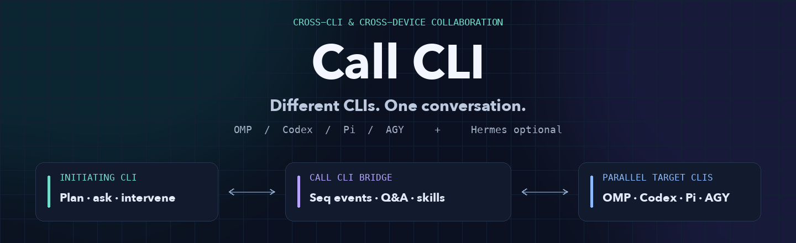
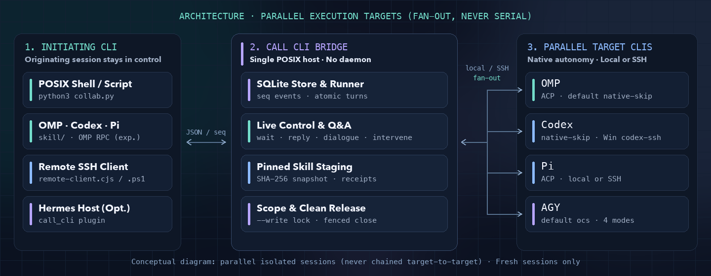
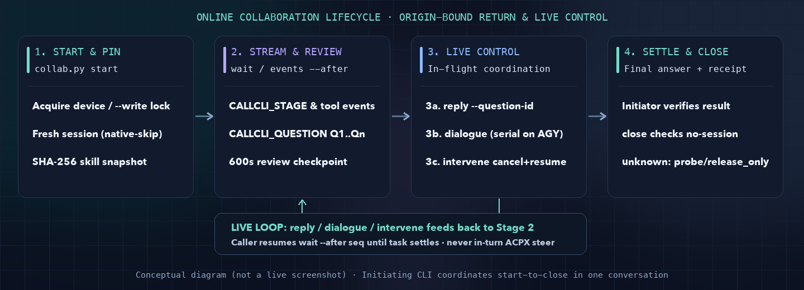

<div align="center">



**给你的 CLI 一个搭档，而不只是另一个子进程。**

<a href="README.md">English</a> · <a href="README.zh-CN.md"><strong>简体中文</strong></a>

<a href="https://github.com/openclaw/acpx"></a>
<a href="LICENSE"></a>

[快速开始](#快速开始) · [选择接入方式](#选择接入方式) · [核心能力](#核心能力) · [架构与协作周期](#工作原理) · [证据分层与边界](#证据与边界) · [文档导览](#文档)

</div>

---

Call CLI 是连接 **OMP、Codex、Pi 与 AGY**（可选集成 Hermes 宿主）的轻量级 POSIX 协作桥，**支持本机协作或复用现有 SSH 连接跨设备运行**。**发起端 CLI 负责统筹**新建目标会话，在**原会话持续接收进展、编号提问与结果回流**，执行期发送**动态调整**（`dialogue` 或显式 `cancel+resume` 的 `intervene`），并在完成后做**独立验收与收尾清理（`close`）**；同时让各目标 CLI 在内部保持**原生自治，不另造第二套任务平台或常驻后台服务**。

**明确边界（不做什么）：** 不强制依赖 Hermes，不新增常驻后台服务或调度器，不把 `cancel+resume` 包装成热插 `steer`，也不接管手动打开的终端、TUI 或桌面 GUI 会话。发起端为 **OMP、Codex、Pi 与 Hermes**；**AGY 仅作执行端**。

## 为什么需要 Call CLI

| | 能力 | 带来的变化 |
| :-- | :-- | :-- |
| 🔄 | **同源回流与复核检查点** | 通过可续读 `seq` 游标在原发起会话跟进阶段进展、提问与最终答案，用共享 600 秒复核检查点代替僵硬超时。 |
| 🧭 | **在线控制（`reply` / `dialogue` / `intervene`）** | 用 `reply` 回答 ACPX 提问，在活跃 AGY 原生 owner 上串行 `dialogue`，或经显式 `intervene`（`cancel+resume`，绝非 `steer`）改向。 |
| 🤖 | **原生 AGY 与四种运行模式** | 默认 **ocs**（Orchestrator Carbon＋原生 Swarm）；支持 `single`、`swarm`、`teamwork` 与 `--agy-mode dynamic`（`/run-workflow`），内部角色与权限原生自治。 |
| 🛡️ | **默认 `native-skip` 与单写者锁** | 新任务默认 `native-skip`（AGY 为 `skip-permissions`）而不改全局 CLI 配置，同时严格保留 `--write` 单写者工作区锁。 |
| 📦 | **按任务固定传递技能** | 经不可变 SHA-256 快照传递本地或执行端技能（`required`、`optional`、`reference`），并记录每轮 `CALLCLI_SKILL` 回执。 |
| 🔌 | **多入口接入与可选宿主桥** | 支持 POSIX 终端、SSH 客户端、CLI 技能、实验性 OMP RPC 扩展、可选 Hermes 插件及未应用的 Hermes 静默兼容补丁。 |

<a id="快速开始"></a>
<a id="quick-start"></a>
## 快速开始

### 方式一：让 AI 帮你完成配置（推荐）

<details>
<summary><strong>点击展开：可复制的 AI 配置提示词与 Agent 执行说明（OMP / Codex / Pi / Hermes）</strong></summary>

将下面这段提示词直接粘贴给你正在使用的 OMP、Codex、Pi 或 Hermes 会话：

```text
请读取 https://github.com/Loveacup/call-cli 中的 README.zh-CN.md 和
docs/configuration.md，并查看 collab.py 与 docs/integrations.md，为当前 CLI 配置 Call CLI。

1. 先只读发现环境：在询问缺失参数前，先检查 python3、node、npm、acpx、现有
   Call CLI 检出目录、SSH 别名、技能目录及目标 CLI 登录状态。保留已有文件、配置与凭据。
2. 按需最小准备：只安装我当前工作流需要的入口、技能或可选 Hermes 模块，不新建常驻服务，
   也不自动应用上游兼容补丁。开始任务前说明每任务一次的 npm 版本检查；软件包升级须在
   设备空闲时经单独授权执行。
3. 分层安全验证：先运行不调用外部模型的本地检查（connect + list）。获得授权后再执行
   真实只读协作验证，关闭自有测试会话（确认 released / no-session），并分别报告源码检查、
   宿主兼容与真实端到端结果及剩余阻塞。
```

链接的 [AI 安装与配置手册（`docs/configuration.md`，简体中文）](docs/configuration.md)是**写给 AI 代理的执行说明**，不是让你逐项手填的配置问卷。详细 AI 手册统一以**简体中文**维护；中英文 README 覆盖完全一致的命令、参数与验证边界。

</details>

### 方式二：在 POSIX 终端直接运行（连续可执行路径）

- **前置条件：** 协调主机须有带 `fcntl` 的 POSIX Python 3.9+（仅标准库；macOS 已实测，Windows 支持作客户端或执行设备，不作协调主机）。阶段 B 真实运行需要 Node.js（>=22.13.0）、npm、导出 `acpx/runtime` 的 ACPX（本机实测 **0.22.0**；Windows SSH OMP 实测 **0.21.1**；基线 **0.20.0**）及原生已登录的目标 CLI（`omp`、`codex`、`pi`、`agy`）。

#### 阶段 A：本地协调核心自检（无需目标模型或凭据）

```sh
git clone https://github.com/Loveacup/call-cli.git
cd call-cli
python3 collab.py --help && python3 collab.py start --help

CALL_CLI_HOME="$PWD"
CALL_CLI_DB="$(mktemp "${TMPDIR:-/tmp}/call-cli-quickstart.XXXXXX")"
CLIENT_JSON="$(python3 "$CALL_CLI_HOME/collab.py" --db "$CALL_CLI_DB" connect --runtime omp)"
CLIENT_ID="$(printf '%s' "$CLIENT_JSON" | python3 -c 'import json,sys; print(json.load(sys.stdin)["client_id"])')"
python3 "$CALL_CLI_HOME/collab.py" --db "$CALL_CLI_DB" --client "$CLIENT_ID" list
```

- **成功判据：** `connect` 返回 UUID `client_id`（`"declared_runtime": "omp"`）；`list` 退出 `0` 且输出 `[]`。仅做阶段 A 时删除 `"$CALL_CLI_DB"` 即可。

#### 阶段 B：真实只读协作（同一 shell 中继续，复用 `CALL_CLI_HOME`、`CALL_CLI_DB`、`CLIENT_ID`）

```sh
acpx --version
TASK_JSON="$(python3 "$CALL_CLI_HOME/collab.py" --db "$CALL_CLI_DB" --client "$CLIENT_ID" \
  start --device local --agent omp --cwd "$CALL_CLI_HOME" \
  --prompt 'Read collab.py and summarize the CLI subcommands in 3 bullet points. Do not modify files.')"
TASK_ID="$(printf '%s' "$TASK_JSON" | python3 -c 'import json,sys; print(json.load(sys.stdin)["id"])')"

WAIT_JSON="$(python3 "$CALL_CLI_HOME/collab.py" --db "$CALL_CLI_DB" --client "$CLIENT_ID" wait --task "$TASK_ID" --after 0 --timeout 5)"
AFTER="$(printf '%s' "$WAIT_JSON" | python3 -c 'import json,sys; print(json.load(sys.stdin)["after"])')"
```

- **进度与控制：** 重复上面的 `wait` 命令，改用 `--after "$AFTER"`，每次更新 `WAIT_JSON` 和 `AFTER`。若 `task.state` 为 `waiting_reply`，先提取问题 ID 并作答，再继续等待。`intervene` 是显式 `cancel+resume`，不是热插指令。失败或 `unknown` 时先检查对账，不要盲目重试或关闭。
  ```sh
  QUESTION_ID="$(printf '%s' "$WAIT_JSON" | python3 -c 'import json,sys; print(json.load(sys.stdin)["task"]["question_id"])')"
  python3 "$CALL_CLI_HOME/collab.py" --db "$CALL_CLI_DB" --client "$CLIENT_ID" reply --task "$TASK_ID" --question-id "$QUESTION_ID" --prompt 'Your answer here'
  ```
- **关闭 OMP 任务：** 仅在任务已结算且结果已复核后关闭（成功为 `completed` 且 `exit_code == 0`），检查关闭结果及列表；不要因为一次 wait 返回就关闭。
  ```sh
  python3 "$CALL_CLI_HOME/collab.py" --db "$CALL_CLI_DB" --client "$CLIENT_ID" close --task "$TASK_ID"
  python3 "$CALL_CLI_HOME/collab.py" --db "$CALL_CLI_DB" --client "$CLIENT_ID" list
  ```
- **调用 AGY 与技能示例：** 不传 `--write`（即 `write: false`）只是**任务范围与单写者工作区互斥声明，而非操作系统或 CLI 沙箱**；默认 `native-skip` 跳过目标 CLI 交互式审批，但**不会解除** ACPX Shared Runtime 的 `fs/*` 回调 `cwd` 限制。仅在需要显式只读拒绝时对 AGY 传入 `--agy-approval approve-reads`：
  ```sh
  node "$CALL_CLI_HOME/models.cjs" "$CALL_CLI_HOME"
  MODEL_ID="gemini-4-argon"  # 替换为 models.cjs 本次返回的精确 availableModelIds 值
  AGY_TASK_JSON="$(python3 "$CALL_CLI_HOME/collab.py" --db "$CALL_CLI_DB" --client "$CLIENT_ID" \
    start --device local --agent agy --agy-swarm off --agy-approval approve-reads --model "$MODEL_ID" \
    --cwd "$CALL_CLI_HOME" --skill reference="$CALL_CLI_HOME/skill" \
    --prompt 'Read the passed skill as reference and list the supported actions. Do not modify files.')"
  AGY_TASK_ID="$(printf '%s' "$AGY_TASK_JSON" | python3 -c 'import json,sys; print(json.load(sys.stdin)["id"])')"
  AGY_WAIT_JSON="$(python3 "$CALL_CLI_HOME/collab.py" --db "$CALL_CLI_DB" --client "$CLIENT_ID" wait --task "$AGY_TASK_ID" --after 0 --timeout 5)"
  AGY_AFTER="$(printf '%s' "$AGY_WAIT_JSON" | python3 -c 'import json,sys; print(json.load(sys.stdin)["after"])')"
  # 重复 wait --after "$AGY_AFTER" 并更新 AGY_WAIT_JSON/AGY_AFTER，结算且复核后再关闭：
  python3 "$CALL_CLI_HOME/collab.py" --db "$CALL_CLI_DB" --client "$CLIENT_ID" close --task "$AGY_TASK_ID"
  python3 "$CALL_CLI_HOME/collab.py" --db "$CALL_CLI_DB" --client "$CLIENT_ID" list
  ```
- **关闭与清理：** `close` 核验本地 closed 记录、同作用域 `no-session`（或原生单 owner 卸载）与技能快照清理；`unknown` 任务仅只读探测，非活跃锁恢复使用显式 `release_only`（接受风险时附 `--abandon`）。先用 `list` 确认全库任务均为 `closed`，再删除 `"$CALL_CLI_DB"`。

> [!NOTE]
> **版本检查不是自动升级：** 每个逻辑新任务查询一次 `acpx --version` 与 `npm view acpx dist-tags.latest`；正常派工绝不安装包（`updates.py` 维护升级需单独授权并在空闲设备锁下执行）。

<a id="选择接入方式"></a>
<a id="choose-your-entry"></a>
## 选择接入方式

| 入口 | 调用形态 | 控制、回流与边界 |
| :-- | :-- | :-- |
| **POSIX 终端／脚本** | `python3 collab.py` | 动作：`connect`、`start`、`list`、`status`、`events`、`wait`、`reply`、`dialogue`、`permission`、`intervene`、`cancel`、`close`、`release_only`、`recovery_status`。`list`/`status`/`events`/`recovery_status` 为纯只读（`?mode=ro`）；短轮询 `wait` 或同 `command_id` 重试 `intervene` 推进已结算介入。`connect --runtime` 为本地句柄声明，非原生宿主身份。 |
| **OMP、Codex 或 Pi** | `skill/` 技能包 + 入口 | 指导发现、`seq` 轮询、问答、`cancel+resume` 与技能传递；不安装依赖，也不代替目标 CLI 原生登录。 |
| **OMP RPC 宿主（实验）** | `omp --mode rpc --no-ui --no-extensions -e /absolute/call-cli/omp-extension.mjs` | 仅新自有 RPC 单次加载（`call_cli_omp`，不含 `reconcile`，包含纯只读 `recovery_status(task_id)`）。原生 `ctx` 绑定身份，绑定前 `list`/`recovery_status` 走只读观察准入且不执行持久 `bind`/建库；观察（`list`/`status`/`events`/`recovery_status`）绝不启动或变更 1 秒 `wait` 轮询，轮询仅由 `start`/控制动作激活并投递 `followUp`；退出只停投递。TUI、ACP defer 与重启恢复未验。 |
| **SSH 远端客户端** | `remote-client.cjs` | 单文件 Node SSH 客户端，将单次 JSON 动作转发至 POSIX 协调主机的 `collab.py`。 |
| **Windows Codex** | `remote-client.ps1` / `codex-ssh.cjs` | `remote-client.ps1` 规避 Windows Codex 沙箱内 Node `spawn(ssh) EPERM`（已核验 macOS 协调端）；`codex-ssh.cjs` 通过 InteractiveToken 在桌面上下文启动 Codex，规避 Session 0 `0xC0000142`。 |
| **Hermes 插件（可选）** | `call_cli`（`__init__.py`、`plugin.yaml`） | 绑定 `HERMES_SESSION_*` 来源，派发后台任务，`list`/`status`/`events`/`recovery_status` 保持纯只读（`?mode=ro`，不隐式推进/拉起；已结算 `intervene` 通过同 `command_id` 显式重试推进），并提供 `reconcile`、`release_only`、`recovery_status`、压缩连续性（`native_continuity.py`）、`local_toolchain_bin` 与释放路由（`dashboard/plugin_api.py`）。新 schema 需宿主刷新或新开会话。 |
| **Hermes 静默补丁** | [`compat/hermes-silence/`](compat/hermes-silence/README.md) | **独立未应用且绝不自动应用。** 固定 `NousResearch/hermes-agent` `2bd378ed1b8d6bf2192cb26e0a55ff3091e6bd19`，由只读 `check.py` 校验；须在空闲干净检出上手动应用/回滚。 |

各入口运行时依赖闭包与加载步骤详见[集成手册（`docs/integrations.md`，简体中文）](docs/integrations.md)。

<a id="核心能力"></a>
<a id="capabilities"></a>
## 核心能力

- **持续协作、问答、检查点与恢复（[`docs/usage.md`](docs/usage.md)、[恢复合同](skill/references/core-requirements.md#写占用恢复合同)）：** 可续读 `seq` 游标分离产生、存储、投递与消费，附无凭据 `recovery` 卡。`CALLCLI_QUESTION Q1 <正文>` 由 `reply`（ACPX）或串行 `dialogue`（活跃 AGY owner）作答；未完整到达边界的 AGY 片段仅暴露阻塞。Hermes/OMP 用共享 **600 秒检查点**代替执行 `timeout`（`--clear-timeout` 清旧预算）。`list`/`status`/`events`/`recovery_status` 保持纯只读（`?mode=ro`）；`intervene` 做幂等 `cancel+resume`（取消结算后由原 controller 以同 `command_id` 重试 `intervene` 或经 `wait` 推进），`close` / `release_only`（`--abandon`）与跨入口 `recovery_status(task_id)` 分离 `resource_state` 与 `business_state`，后者仅投射闭集 `diagnostic` 枚举/计数（不提供跨群批量 `list` 或业务自由文本）。
- **原生 AGY、四种模式与自治（[`skill/references/agy-models.md`](skill/references/agy-models.md)）：** 默认 **ocs**（Orchestrator Carbon＋原生 Swarm）；`oc/oa/4c/4a/4h` 选 `single`，`s` 选 `swarm`，`t` 选 `teamwork`，`--agy-mode dynamic` 跑 `/run-workflow`（`models.cjs` 查精确 ID）。AGY 原生自治内部角色与子代理（`agy_native.py`、`agy_dynamic.py`）；Call CLI 对 `session/load` 做 Fail-Closed 校验、捕获致命哨兵、投影 `AUTH_REQUIRED` 并单次转发原生取消，不虚构子证明。
- **默认 `native-skip` 与 `--write` 互斥锁：** 新任务默认 `execution_policy: "native-skip"`（AGY 为 `skip-permissions`；`--agy-approval approve-all|approve-reads` 恢复审批，旧任务不变），不改全局 CLI 配置（`~/.acpx`、`~/.codex`、`~/.omp`、`~/.pi`、`~/.gemini`）。**`native-skip` 仅跳过目标 CLI 交互提示／CLI 沙箱，不解除 ACPX Shared Runtime 的 `fs/*` `cwd` 限制。** `--write` / `write: false`（`--resource`）声明**任务范围与单写者锁**，**非 OS 或文件系统沙箱**。
- **固定技能（[`skill/references/skill-passing.md`](skill/references/skill-passing.md)）与后端（[`docs/integrations.md#后端扩展接口`](docs/integrations.md#后端扩展接口)）：** 通过 `--skill`、`--target-skill`、`--skills-json` 传递 `required`/`optional`/`reference` 技能包与不可变 SHA-256 快照、记录 `CALLCLI_SKILL` 回执。ACPX `0.21.1`/`0.22.0` 中 `SharedAcpRuntime` `fs/*` 仍限 `cwd` 子树，跨目录依赖 CLI 原生文件工具（否则 `unavailable`）。后端经 `backends.py` 注册，ACPX 须满足 `exit 0`、`end_turn` 与工具后最终回答。


*概念示意图（非实时运行截图）：手机端可[打开高清多模式与权限边界图](docs/assets/call-cli-modes.png)缩放查看。*

<a id="工作原理"></a>
<a id="how-it-works"></a>
## 架构与协作生命周期

<div align="center">



</div>

[打开高清架构图](docs/assets/call-cli-architecture.png)——手机端建议打开原图后缩放查看。

*概念架构图（非实时截图）：由单一发起入口持有任务（`bridge.py` / `runner.py`），向本机或 SSH 远端的**并列、隔离且内部原生自治的目标 CLI 会话**（`OMP`、`Codex`、`Pi`、`AGY`）并行扇出。连线不代表串联依赖（也不禁止用户授权的分层协调），且绝不接管手动打开的终端。*

 2 事件流与 600 秒检查点 -> 3 执行期控制（reply / dialogue / intervene cancel+resume 回环至阶段 2）-> 4 结算与核验关闭" width="100%">

*概念生命周期图（非实时运行截图）：手机端可[打开高清协作生命周期图](docs/assets/call-cli-lifecycle.png)缩放查看。*

**控制语义：** 公开 ACPX 0.22.0 拒绝执行期 `steer`，`queue` 只排队不中断改向。因此 `intervene` 使用显式**取消并续轮（cancel-and-resume）**（`command_id`），而 `dialogue` 在不取消活跃 AGY 原生会话的前提下将同轮输入串行排队发送。

<a id="证据与边界"></a>
<a id="evidence-and-boundaries"></a>
## 证据分层与验证边界

Call CLI 严格区分**已发布源码、离线套件、原生协议探针、抽样真实协作与宿主／用户投递**（详见 [`skill/references/core-requirements.md`](skill/references/core-requirements.md) 与 [`VERIFICATION.md`](VERIFICATION.md)）：

| 验证层级 | 已核验范围 | 明确边界／未宣称范围 |
| :-- | :-- | :-- |
| **公开源码与离线检查** | 历史发布前完整发现：Python 497 项、跳过 12 项。脱敏候选：Python 241 项；Node 99/101、跳过 2 项。发布后精确 clone：Python 38 项；Node 身份测试 5/7、跳过 2 项；释放证明与 CLI 帮助通过。详见[验证记录](VERIFICATION.md)。 | 各树及范围不同；脱敏候选**未执行**完整 497 项。不能据此推断真实模型或部署宿主验收通过。 |
| **原生 ACPX 与 AGY 探针（`RUN_NATIVE_ACPX_TESTS=1`）** | Opt-in 的 `test_native_shared`、`test_native_skills` 与 `test_native_release` 在 ACPX 0.22.0 + 合成 ACP 端点全部通过；另含 AGY `session/load` 与零 prompt 模型读回（`test_agy_native_owner.py`）。 | 合成端点有界探针 — 不等于全部大模型多轮与取消场景通过。 |
| **本机与 SSH 抽样真实运行** | 抽样 macOS/Windows SSH 与 AGY 原生样本索引于 `VERIFICATION.md`。 | 仅限采样目标／模型；工具热取消、全后代停止证明及真实宿主 Teamwork 端到端仍未验证。 |
| **宿主适配与静默补丁** | 可选 Hermes 插件（`__init__.py`）、OMP RPC 扩展（`omp-extension.mjs`）及未应用 `compat/hermes-silence/`（`compat/hermes-silence/run_tests.py` 5 文件套件 `138` 项通过）。 | 新 schema 需宿主刷新或新会话；源码检查不证明所有原会话消费、运行中 gateway 已加载补丁、Telegram 端到端投递、上游 AGY 错误文案或离线自动唤醒。 |

```sh
# 运行标准离线验证套件（无需模型凭据或联网）
python3 -B -m unittest discover -v
node --test test_skill_stage.cjs test_shared_prompt.cjs test_models.cjs test_codex_ssh.cjs test_omp_extension.mjs test_control_identity.cjs
node test_release_backend.cjs

# 可选：真实本机 ACPX queue-owner + 合成 ACP 端点集成测试（无真实大模型调用）
RUN_NATIVE_ACPX_TESTS=1 python3 -B -m unittest test_native_skills test_native_shared test_native_release -v
```

<details>
<summary><strong>授权前请阅读：范围与安全边界</strong></summary>

- **只新建协作会话：** 绝不接入手动打开的终端、TUI 或 GUI。
- **不是操作系统沙箱：** 新任务默认 `native-skip`（AGY 为 `skip-permissions`，可传 `--agy-approval approve-all|approve-reads` 退回；旧任务不变）。`write: false` 与释放围栏不隔离系统文件系统，也不证明脱离后代已停止；`--write` 锁与全局 CLI 配置（`~/.acpx`、`~/.codex`、`~/.omp`、`~/.pi`、`~/.gemini`）保持不变。
- **ACPX `fs/*` `cwd` 限制：** 在 ACPX `0.21.1`/`0.22.0` 中，`fs/*` 回调即使在 `native-skip` 下仍限 `cwd` 子树；跨目录技能读取依赖 CLI 原生文件工具。
- **先对账再重试与私有状态：** `unknown` 结果绝不重放（先 `close`/`reconcile` 只读探测，或显式 `release_only`）。将 SQLite 库、`client_id` 句柄、`release-policy.json` 与凭据置于单协调主机私有目录。

</details>

<a id="文档"></a>
<a id="documentation"></a>
## 文档导览

### 给使用者和贡献者

[验证记录（`VERIFICATION.md`，English）](VERIFICATION.md) · [路线图（`ROADMAP.md`，简体中文）](ROADMAP.md) · [安全说明（`SECURITY.md`，English）](SECURITY.md) · [贡献指南（`CONTRIBUTING.md`，English）](CONTRIBUTING.md) · [许可证（`LICENSE`）](LICENSE)

### 给实际操作 Call CLI 的 AI

<details>
<summary><strong>点击展开：专供 AI 代理阅读的操作手册与参考索引</strong></summary>

| 手册 | 内容概要 | 语言 |
| :-- | :-- | :-- |
| [安装与配置（`docs/configuration.md`）](docs/configuration.md) | 环境发现、SSH 别名、ACPX 配置、认证、权限与验收。 | 简体中文 |
| [CLI／模块接入（`docs/integrations.md`）](docs/integrations.md) | 技能安装、OMP RPC、Hermes 插件、恢复与 `backends.py`。 | 简体中文 |
| [在线协作（`docs/usage.md`）](docs/usage.md) | `seq` 游标、`CALLCLI_QUESTION`、`reply`、`dialogue`、`intervene`、600s 检查点、`--clear-timeout`、`close`、`release_only`。 | 简体中文 |
| [当前核心需求（`skill/references/core-requirements.md`）](skill/references/core-requirements.md) | 双向协作、AGY 薄桥、`native-skip`、恢复与证据分层。 | 简体中文 |
| [任务技能传递（`skill/references/skill-passing.md`）](skill/references/skill-passing.md) | 本地优先选择、仓库线索、`required`/`optional`/`reference` 模式与 `CALLCLI_SKILL`。 | 简体中文 |
| [AGY 模型、Swarm 与审批（`skill/references/agy-models.md`）](skill/references/agy-models.md) | 默认 `ocs`、简称规则、精确 ID、单 owner 结算与边界。 | 简体中文 |
| [Hermes 宿主与连续性（`skill/references/hermes-host.md`）](skill/references/hermes-host.md) | 来源捕获、压缩连续性、已结束 owner 恢复与 `[SILENT]` 指导。 | 简体中文 |
| [维护源与安装检查（`skill/references/maintenance.md`）](skill/references/maintenance.md) | 每次任务维护检查与空闲设备 ACPX 升级边界。 | 简体中文 |
| [Windows Codex SSH（`CODEX_SSH.md`）](CODEX_SSH.md) | 桌面 `codex-ssh.cjs` 桥接与原生 PowerShell（`remote-client.ps1`）。 | 简体中文 |
| [可选 Hermes 静默补丁（`compat/hermes-silence/README.md`）](compat/hermes-silence/README.md) | 未应用补丁（固定 `NousResearch/hermes-agent` `2bd378ed1b8d6bf2192cb26e0a55ff3091e6bd19`）、`check.py`、回滚与测试。 | English |

</details>

*注：`docs/assets/render_banner.py` 仅重新生成配图时使用 Pillow；Pillow 非运行时或测试依赖。*

## 致谢

基于 [ACPX](https://github.com/openclaw/acpx) 与 OMP、Codex、Pi、AGY、Hermes 的原生能力构建。Call CLI 是独立项目，不隶属于上述上游项目。

<div align="center">

**工具各有长处，协作保持同向。**

[MIT 许可证](LICENSE) · [English](README.md)

</div>
