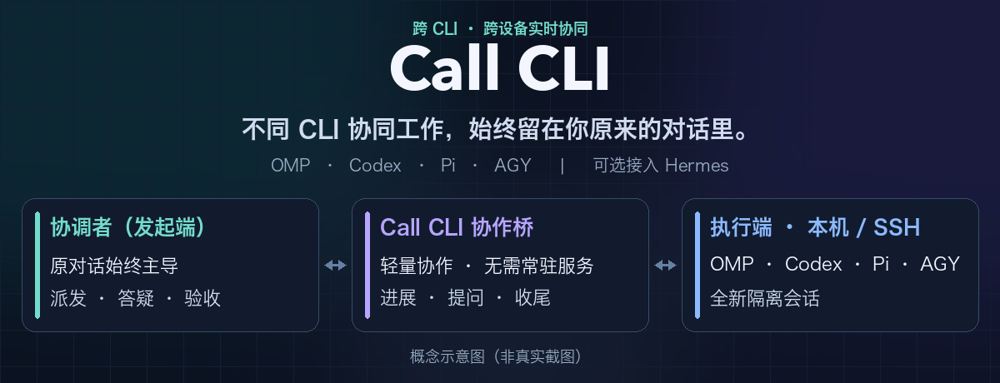
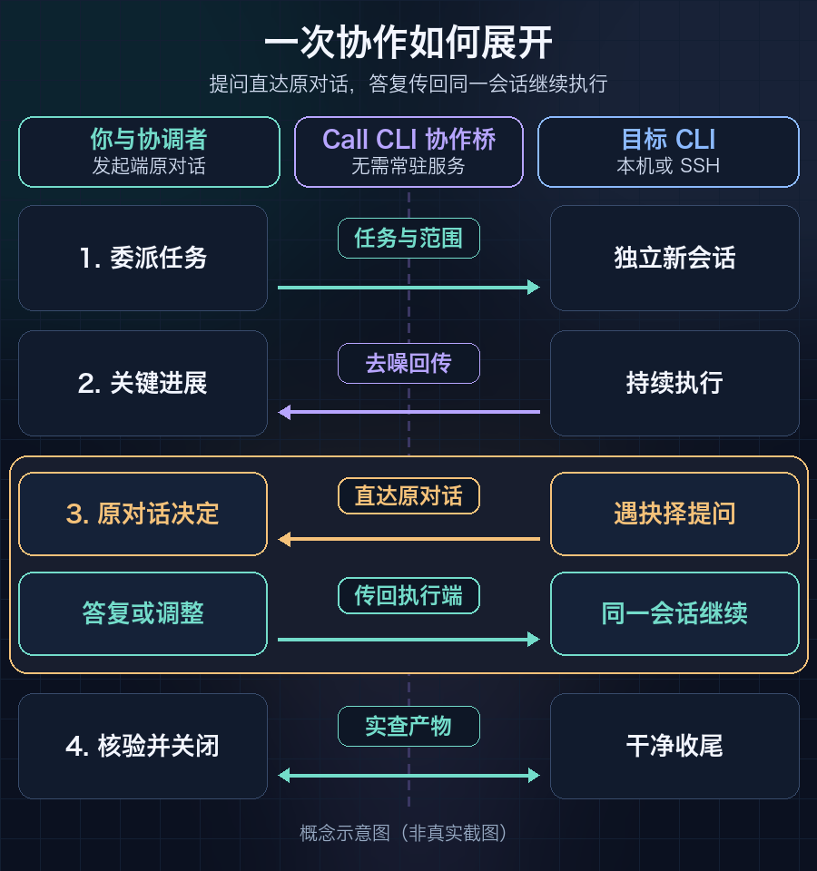
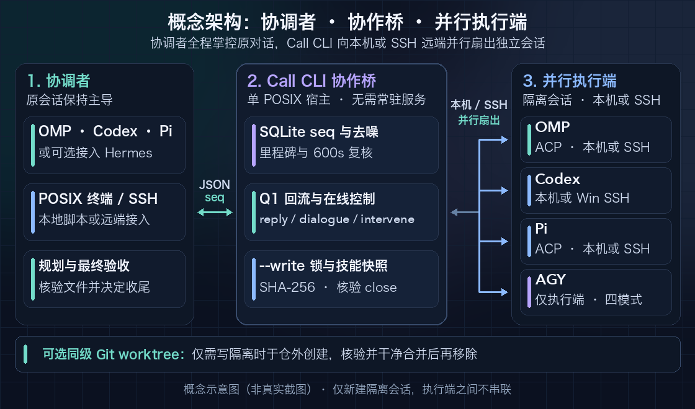

<div align="center">



**把工作交给其他 CLI，但始终留在你原来的对话里。**

<a href="README.md">English</a> · <a href="README.zh-CN.md"><strong>简体中文</strong></a>

<a href="https://github.com/openclaw/acpx"></a>
<a href="LICENSE"></a>

[为什么需要 Call CLI](#为什么需要-call-cli) · [一次协作如何展开](#一次协作如何展开) · [角色分工与核心边界](#角色分工与核心边界) · [首次体验](#首次体验) · [OAR 路线](#oar-路线) · [验证证据与安全边界](#验证证据与安全边界) · [AI 配置与完整手册](#ai-配置与完整手册)

</div>

---

<a id="为什么需要-call-cli"></a>
<a id="why-call-cli"></a>
## 为什么需要 Call CLI？

当你在 **Hermes**（或 **OMP**、**Codex**、**Pi**）里已经聊清了上下文、准备把某项编码或排查任务交给另一款擅长的原生 CLI——无论是在本机，还是通过现有 SSH 连到另一台设备——最怕遇到五件事：另开一堆终端重新粘贴背景、执行到一半遇到需要拍板的问题你得在两个窗口间当“人肉传话筒”、半天没动静时分不清它是在认真改代码还是陷入空转、多个任务同时修改同一份未提交改动，或者看到子进程正常结束就误以为活儿已经干完。

Call CLI 把主次关系理顺了：你正在使用的发起端 CLI 始终是**协调者**，稳稳守在你原来的对话里；Call CLI 本身是一座轻量的 POSIX **协作桥**（**无需常驻服务**），负责把它连接到本机或 SSH 远端新启动的原生**执行端**（`OMP`、`Codex`、`Pi`、`AGY`）。进展里程碑、需要你拍板的问题、执行中的调整和最终验收，全部回到你最开始的那条对话。

**明确边界（不做什么）：**
- **不强制依赖 Hermes，也无需常驻服务或独立调度平台：** 所有协作都按需在单台协调主机上完成，不另起守护进程。
- **只新建隔离的原生会话：** 绝不接管、附着或向你手动打开的终端、TUI 或桌面 GUI 会话注入消息。
- **发起端与执行端边界明确：** 发起端为 **Hermes、OMP、Codex、Pi**；**AGY 仅作执行端**（不作发起端）。
- **控制语义与文件锁边界坦诚说明：** 执行中调整方向的能力因目标运行时而异，先取消旧轮再在同一会话续跑并非无损热改向；工作区写互斥锁用于协调同一目录的并发编辑，并非操作系统沙箱。

<a id="一次协作如何展开"></a>
<a id="how-a-collaboration-works"></a>
## 一次协作如何展开

<div align="center">



</div>

*概念示意图（非真实截图或实时运行记录）。手机端可[打开高清协作流程图](docs/assets/call-cli-walkthrough.zh-CN.png)缩放查看。*

> **以下为示意场景，非真实运行取证**：假设你正在 **Hermes**（或 **Codex** / **OMP**）里处理一个仓库，希望把其中一处局部修复和配套测试交给本机的 **AGY** 或远端 SSH 上的 **Codex** 完成。

1. **明确范围并启动（可选仓外隔离）：** 在本机或已有 SSH 上拉起全新会话（需要特定方法或规范时可随任务固定附上参考技能）；普通目录保持普通目录，单写者仓库直接就地推进并保护用户既有改动，只有确实需要并行改代码或写隔离时，才在仓库外准备同级 Git worktree（**并非所有任务自动建树**，若隔离准备或路径校验失败则直接停工报错，不静默回退写入主目录）。

2. **只看有用的进展，不被刷屏：** 日常琐碎的工具日志会被过滤掉，只有真正推进的里程碑、阻塞，以及任务长时间安静或疑似原地打转时的定期复核提醒才会回到原对话——不会用硬超时擅自砍断活跃任务。

3. **真实抉择问题直接回到原对话：**
   > **执行端提问：** “旧配置文件里的非法时间戳，应该直接报错拦下（fail closed），还是为了向后兼容回退到 UTC？”
   > **你在原对话答复：** “新写入直接报错，旧数据导入保留 UTC 回退，并把两种情况都补上测试。”
   属于既定范围内的常规工程问题可由协调者自行处理，涉及取舍的真问题会直接送回你原来的对话；你的决定传回后，**同一个执行端会话接着往下跑**。

4. **执行中随时纠偏（控制能力因运行时而异）：** 中途想法有变，在原对话直接告诉协调者即可。活跃的 AGY 原生会话会按序排队接收更新；常规 ACPX 路径则是先取消当前轮、确认原轮结算后再在同一会话续跑，绝不冒称为无损热改向（steer）。

5. **独立验收并干净收尾：** 进程结束不代表活儿已干完。协调者会实际检查文件和测试结果；如果使用了可选的仓外同级 worktree，会在核验后再干净合并并移除临时副本（同时保护无关用户改动，无法安全清理时说明原因保留），最后关闭目标会话。

如需查看具体的事件游标、单写者锁、原生控制协议与 worktree 细节，可展开下方**概念架构图与运行细节**，或直接阅读 [在线协作手册（`docs/usage.md`）](docs/usage.md)。

<a id="角色分工与核心边界"></a>
<a id="roles-and-boundaries"></a>
## 角色分工与核心边界

| 角色 | 由谁承担 | 核心职责 | 明确边界 |
| :--- | :--- | :--- | :--- |
| **协调者** | 你当前使用的发起端 CLI（**Hermes**、**OMP**、**Codex**、**Pi**） | 在原对话界定任务范围、按需决定是否准备仓外同级副本、阅读阶段里程碑与复核提醒、拍板或转述真实问题、独立验收文件与测试并收尾。 | 不逐行刷屏转播，不把进程正常结束当成验收通过；**AGY 不作发起端**，也不擅自清理或回退用户工作区。 |
| **Call CLI 协作桥** | 运行在协调主机上的轻量桥接层（**无需常驻服务**） | 维护任务归属与隔离句柄、去噪回传里程碑与问题、提供定期复核提醒、协调工作区单写者互斥锁，并支持按任务固定传递参考技能。 | 无常驻调度服务，不接管手动打开的终端或 GUI；只读查询不会偷偷推进或重启任务；文件锁也不是操作系统沙箱。 |
| **执行端** | 本机或 SSH 远端新启动的原生 **OMP**、**Codex**、**Pi**、**AGY**（`AGY` 仅作执行端） | 在指定工作目录的全新隔离会话内完成读写、工具调用与排查；原生自治内部多模式或子代理协作；遇阻或需拍板时向外提问。 | 仅限全新独立会话，不与其他执行端串联依赖，不凭自报“完成”代替协调者独立验收，不向外泄露原始思维链或凭据。 |

<details>
<summary><strong>概念架构图与运行细节</strong></summary>

<div align="center">



</div>

*概念示意图（非实时截图）：由单一协调入口持有任务（`bridge.py` / `runner.py`），向本机或 SSH 远端的**并行、彼此隔离且内部原生自治的执行端会话**（`OMP`、`Codex`、`Pi`、`AGY`）扇出派工。图中连线不代表执行端之间存在串联依赖（也不禁止用户明确授权的分层协调），且绝不接管手动打开的终端。手机端可[打开高清概念架构图](docs/assets/call-cli-architecture.zh-CN.png)缩放查看。*

### 核心工作流与能力边界

- **接入入口与跨平台传输（[集成手册 `docs/integrations.md`](docs/integrations.md)）：** 包含纯 POSIX 入口 `collab.py`、通用协作技能包 `skill/`、单文件 SSH 客户端 `remote-client.cjs`、针对 Windows Codex 沙箱内 Node `spawn(ssh) EPERM` 与 OpenSSH Session 0 `0xC0000142` 的原生 `remote-client.ps1` + 桌面桥 `codex-ssh.cjs`（见 [`CODEX_SSH.md`](CODEX_SSH.md)）、实验性 OMP RPC 扩展 `omp-extension.mjs`、可选 Hermes 插件 `call_cli`（含来源绑定、轮转压缩连续性 `native_continuity.py`、`local_toolchain_bin` 与 dashboard 固定目标释放路由），以及独立未应用且绝不自动应用的可选静默补丁（见 [`compat/hermes-silence/README.md` (English)](compat/hermes-silence/README.md)）。
- **AGY 原生模式（[AGY 模型与模式合同 `skill/references/agy-models.md`](skill/references/agy-models.md)）：** `AGY` 仅作执行端。新任务默认 **ocs**（Orchestrator Carbon `gemini-pro-orchestrator` + 原生 Swarm）；支持通过简称或 `--agy-mode` 使用 `single`（`oc`/`oa`/`on`/`4c`/`4a`/`4h`/`4n`/`g4c`/`g4a`/`g4h`/`g4n`）、`swarm`（后缀 `s`，含 `ons` -> `gemini-pro-orchestrator-neon` 与 `g4hs`/`4hs` -> `gemini-4-hydrogen`）、`teamwork`（后缀 `t`）与 `--agy-mode dynamic`（原生 `/run-workflow`），精确模型与 `thought_level` 通过执行设备上的 `models.cjs` 发现。内部角色与子代理均由 AGY 原生自治，Call CLI 只对单一 owner 做 `session/load` Fail-Closed 校验、致命输出哨兵拦截、安全 `AUTH_REQUIRED` 分类与单次原生取消转发。
- **默认 `native-skip` 与 `--write` 单写者锁（[核心需求正本 `skill/references/core-requirements.md`](skill/references/core-requirements.md)）：** 新启动的 `OMP`、`Codex`、`Pi`、`AGY` 默认持久化 `execution_policy: "native-skip"`（AGY 为 `skip-permissions`，可显式 `--agy-approval approve-all|approve-reads` 退回非 skip 门禁；旧任务保持原有策略），且**不改动全局 CLI 配置**（`~/.acpx`、`~/.codex`、`~/.omp`、`~/.pi`、`~/.gemini`）。`--write` / `write: false` / `--resource` 是单写者互斥锁，**不是操作系统沙箱**；在 ACPX `0.21.1`/`0.22.0` 中，`SharedAcpRuntime` 的 `fs/*` 回调仍硬性限制在 `cwd` 子树内，跨目录读写依赖各 CLI 自有原生文件工具。
- **可选 Git/worktree 与只读恢复对账（[在线协作手册 `docs/usage.md`](docs/usage.md)、[写占用恢复合同 `skill/references/core-requirements.md#写占用恢复合同`](skill/references/core-requirements.md#写占用恢复合同)）：** `git_worktree.py` 由协调者按需调用（`init-repo`、`prepare`、`inspect`、`harvest`、`converge`、`check-cleanup`、`cleanup`），强制仓外同级目录与 Fail-Closed 校验。`list` / `status` / `events` / `recovery_status` 均采用 SQLite 纯只读访问（`?mode=ro` + `PRAGMA query_only=ON`），不建库、不加锁、不推进介入、不拉起进程；遇到 `unknown` / HOLD 占锁先只读探测对账，仅在确认无活跃工作并接受风险时才使用显式 `release_only`（`--abandon`）释放资源。
- **任务固定技能与可扩展后端（[技能传递 `skill/references/skill-passing.md`](skill/references/skill-passing.md)、[后端扩展接口 `docs/integrations.md#后端扩展接口`](docs/integrations.md#后端扩展接口)）：** 支持 `--skill`、`--target-skill` 与 `--skills-json` 传递 `required` / `optional` / `reference` 技能目录，通过不可变 SHA-256 快照固定内容，并逐轮核对 `CALLCLI_SKILL` 回执；执行后端统一经 `backends.py` 注册，共享同一任务状态机与结算约束（详见 [`VERIFICATION.md#current-acceptance-index`](VERIFICATION.md#current-acceptance-index)）。

</details>

<a id="首次体验"></a>
<a id="first-win"></a>
## 首次体验：本地无模型自检

在拥有带 `fcntl` 的 POSIX Python 3.9+ 的主机上（纯标准库；macOS 已实测，Windows 可作客户端或执行设备，不作协调主机），无需任何模型凭据、Node.js 或 ACPX，即可在临时数据库中完成本地协调核心自检（任一步失败都会在子 shell 内立即报错中止）：

```sh
git clone https://github.com/Loveacup/call-cli.git && cd call-cli

(
  set -eu
  CALL_CLI_DB="$(mktemp "${TMPDIR:-/tmp}/call-cli-first-win.XXXXXX")"
  trap 'rm -f "$CALL_CLI_DB"' EXIT
  CLIENT_JSON="$(python3 collab.py --db "$CALL_CLI_DB" connect --runtime omp)"
  printf '%s\n' "$CLIENT_JSON"
  CLIENT_ID="$(printf '%s' "$CLIENT_JSON" | python3 -c 'import json,sys; print(json.load(sys.stdin)["client_id"])')"
  python3 collab.py --db "$CALL_CLI_DB" --client "$CLIENT_ID" list
)
```

- **可观察的成功判据：** `connect` 返回包含 UUID `client_id` 与 `"declared_runtime": "omp"` 的 JSON；`list` 退出码为 `0` 并输出 `[]`；临时任务库在退出子 shell 时自动清理，全程无需常驻服务、不修改全局 CLI 配置。
- **下一步：** 想让 AI 帮你完成宿主配置，或查看包含真实模型调用的完整只读协作命令，请展开下方 [AI 配置、宿主激活前置条件与完整手册](#ai-配置与完整手册)。

<a id="oar-路线"></a>
<a id="oar-roadmap"></a>
## OAR 路线

我们正在逐步将底层的**执行层**向 [Open Agent Runtime（OAR）](https://github.com/botiverse/oar) 演进，以便在任务执行期间提供更清晰的实时状态可见性，并在底层运行时支持时直接于轮次中途调整方向，而不必先取消再重新开始一轮。无论执行层如何演进，任务的归属权、结果回到哪一个原对话以及最终独立验收，依然牢牢掌握在发起端 CLI（如 Hermes、OMP、Codex、Pi）手中。

**当前现状：** OAR 目前仍处于实验阶段。现阶段仅可通过 `collab.py start --backend oar` 显式启用，且**仅限新建的本机 AGY 单代理任务**（需通过 `CALL_CLI_OAR_DIST` 指向包含 `dist/` 的 `@botiverse/oar` 包根目录，并需要 Node.js 24+）；**没有任何默认迁移**——包括 ACPX 默认路由以及 AGY 原生 Swarm / Teamwork / Dynamic 在内的既有路径均保持不变，且 **Hermes 与 OMP 的宿主工具暂不暴露该开关**。详细前置条件与范围限制请参阅 [在线协作手册（`docs/usage.md`）](docs/usage.md) 与 [路线图（`ROADMAP.md`）](ROADMAP.md)。

<a id="验证证据与安全边界"></a>
<a id="evidence-and-safety"></a>
## 验证证据与安全边界

- **证据分层严格隔离：** Call CLI 将**公开源码、离线测试套件、原生协议探针、抽样真实运行与宿主／用户投递**严格分开报告——离线夹具全绿不等于实装宿主已加载，更不等于真实用户终端已收到消息。完整事实索引见 [验证记录（`VERIFICATION.md`，English）](VERIFICATION.md) 与发布范围说明 [2026-11-18 发布说明（English）](docs/publication-2026-11-18.md)、[2026-11-16 发布说明（English）](docs/publication-2026-11-16.md)。
- **信任与安全边界：** 本工具是面向单用户的实验性协调桥，并非多租户执行服务或操作系统沙箱；`client_id` 仅为本地能力句柄而非强认证身份。请将任务 SQLite 库、`client_id`、`release-policy.json` 与凭据保存在单一协调主机的私有目录内，授权访问前先阅读 [安全说明（`SECURITY.md`，English）](SECURITY.md) 并核对目标 CLI 的原生权限模型。
- **版本检查不是自动升级：** 每个逻辑新任务仅在派工前查询一次执行端的 `acpx --version` 与 `npm view acpx dist-tags.latest`；正常派工绝不安装或升级任何软件包（通过 `updates.py` 进行的维护升级必须单独授权并在设备空闲锁下执行）。

<details>
<summary><strong>离线验证命令与详细证据边界</strong></summary>

| 验证层级 | 已核验范围 | 明确边界／未宣称范围 |
| :--- | :--- | :--- |
| **公开源码与离线检查** | 2026-11-15 公开源码更新：Python 定向 241 项（含继承/重复执行计数）通过、Node 99/101 通过（2 项 opt-in 原生 SDK 用例跳过）、`node test_release_backend.cjs` 输出 `STRICT_NATIVE_RELEASE_PROOF_OK`；既有完整离线基线为 Python 357 项（345 通过、12 跳过）与 6 文件 Node 81 项；另有 OCS 141 项、Teamwork 薄桥 9/9 等增量记录索引于 [`VERIFICATION.md`](VERIFICATION.md)。 | 不同源码快照与测试范围不可直接相加；离线夹具与合成传输**均不**证明真实大模型行为、Windows PowerShell 实机执行或已部署宿主验收通过。 |
| **原生 ACPX 与 AGY 探针（`RUN_NATIVE_ACPX_TESTS=1`）** | Opt-in 的 `test_native_shared`、`test_native_skills` 与 `test_native_release` 在 ACPX 0.22.0 + 合成 ACP 端点全部通过；另含 AGY `session/load` 与零 prompt 模型读回（`test_agy_native_owner.py`）。 | 仅限合成端点有界探针，不等于全部大模型多轮对话、热取消或各类 provider 场景已通过。 |
| **本机与 SSH 抽样实跑** | 抽样 macOS / Windows SSH 协作与 AGY 原生样本索引于 [`VERIFICATION.md`](VERIFICATION.md)。 | 仅代表当时采样目标与模型；运行中工具热取消、任意脱离后代停止证明及真实宿主 Teamwork 端到端闭环仍未验证。 |
| **宿主适配与静默补丁** | 可选 Hermes 插件（`__init__.py`）、实验性 OMP RPC 扩展（`omp-extension.mjs`）及未应用的 [`compat/hermes-silence/`](compat/hermes-silence/README.md)（`compat/hermes-silence/run_tests.py` 5 文件套件 138 项通过）。 | 新 schema 需宿主刷新或新开会话才会生效；源码检查不证明所有既有会话已消费、运行中 gateway 已加载补丁、Telegram 端到端投递、上游 AGY 错误文案或离线自动唤醒。 |

```sh
# 运行标准离线验证套件（无需模型凭据或联网）
python3 -B -m unittest discover -v
node --test test_skill_stage.cjs test_shared_prompt.cjs test_models.cjs test_codex_ssh.cjs test_omp_extension.mjs test_control_identity.cjs
node test_release_backend.cjs

# 可选：真实本机 ACPX queue-owner + 合成 ACP 端点集成测试（无真实大模型调用）
RUN_NATIVE_ACPX_TESTS=1 python3 -B -m unittest test_native_skills test_native_shared test_native_release -v
```

**授权访问前请核对范围与安全边界：**
- **仅新建原生会话：** 绝不接管、附着或向手动打开的终端、TUI 或桌面 GUI 会话注入输入。
- **不是操作系统沙箱：** 新任务默认 `execution_policy: "native-skip"`（AGY 为 `skip-permissions`，可显式传 `--agy-approval approve-all|approve-reads` 退回；旧任务保留原策略不变）。`write: false` 与 SQL 释放围栏都不隔离系统文件系统，也不证明脱离后的子孙进程已停止；`--write` 锁与全局 CLI 配置（`~/.acpx`、`~/.codex`、`~/.omp`、`~/.pi`、`~/.gemini`）均保持不变。
- **ACPX `fs/*` `cwd` 限制：** 在 ACPX `0.21.1`/`0.22.0` 中，即使开启 `native-skip`，`SharedAcpRuntime` 的 `fs/*` 回调仍硬性限在 `cwd` 子树内；跨目录读取技能文件依赖目标 CLI 自有原生文件工具。
- **先对账再重试与私有状态：** 遇到 `unknown` 结果绝不自动重放（先用 `close` / `reconcile` 只读探测，或经显式 `release_only` 恢复）。请将 SQLite 库、`client_id` 句柄、`release-policy.json` 与凭据放在单一协调主机的私有目录中。

</details>

<a id="ai-配置与完整手册"></a>
<a id="ai-setup-and-manuals"></a>
## AI 配置、宿主激活前置条件与完整手册

<details>
<summary><strong>1. 可复制的 AI 配置提示词（OMP / Codex / Pi / Hermes）</strong></summary>

将下面这段提示词直接粘贴到你当前使用的 **OMP**、**Codex**、**Pi** 或 **Hermes** 会话中，让 AI 先只读发现环境，再按需最小配置：

```text
请读取 https://github.com/Loveacup/call-cli 中的 README.zh-CN.md 和
docs/configuration.md，并查看 collab.py 与 docs/integrations.md，为当前 CLI 配置 Call CLI。

1. 先只读发现环境：在询问缺失参数前，先检查 python3、node、npm、acpx、现有
   Call CLI 检出目录、SSH 别名、技能目录及目标 CLI 登录状态。保留已有文件、配置与凭据。
2. 按需最小准备：只安装我当前工作流需要的入口、技能或可选 Hermes 模块，不新建常驻服务，
   也不自动应用上游兼容补丁。开始任务前说明每任务一次的 npm 版本检查；软件包升级须在
   设备空闲时经单独授权执行。
3. 分层安全验证：先运行不调用外部模型的本地检查（connect + list）。获得授权后再执行
   真实只读协作验证，关闭自有测试会话（确认 released / no-session），并分别报告源码检查、
   宿主兼容与真实端到端结果及剩余阻塞。
```

链接的 [AI 安装与配置手册（`docs/configuration.md`，简体中文）](docs/configuration.md)是**写给 AI 代理的执行说明**，不是让你逐项手填的配置问卷。完整操作手册统一以**简体中文**维护；中英文 README 覆盖完全一致的命令、参数与验证边界。

</details>

<details>
<summary><strong>2. 宿主激活前置条件、接入入口矩阵与完整只读协作命令示例</strong></summary>

### 运行前置条件与激活要求

- **协调主机：** 带 `fcntl` 的 POSIX Python 3.9+（纯标准库；macOS 已实测，Windows 支持作客户端或执行设备，不作协调主机）。
- **真实协作执行端：** Node.js（>=22.13.0）、npm、导出 `acpx/runtime` 的全局 ACPX（本机实测 **0.22.0**；Windows SSH OMP 实测 **0.21.1**；基线 **0.20.0**），以及已原生登录的目标 CLI（`omp`、`codex`、`pi`、`agy`）。
- **实验性 OAR 后端（`--backend oar`）：** 仅限新建的本机 AGY 单代理任务；需 Node.js 24+ 及指向含 `dist/` 的 `@botiverse/oar` 包根目录的 `CALL_CLI_OAR_DIST`（集成夹具验证版本 **0.121.0**）。
- **宿主工具刷新：** 更新 Hermes `call_cli` 插件或 OMP RPC 扩展后，必须由宿主刷新工具快照或新开会话才能看到新 schema（已打开的旧会话不会自动更新工具集）。
- **可选 Hermes 静默补丁：** [`compat/hermes-silence/`](compat/hermes-silence/README.md) 是独立未应用的源码补丁，固定匹配 `NousResearch/hermes-agent` 提交 `2bd378ed1b8d6bf2192cb26e0a55ff3091e6bd19` 并附带只读校验门禁 `check.py`，绝不自动应用。
- **AGY 原生简称与 Hermes gateway 重载边界（`backends.py`）：**
  1. **已入库 AGY 简称（`_AGY_ALIASES` / `prepare_start`）：** `ons` 对应 **Neon 原生 Swarm**（`model="gemini-pro-orchestrator-neon"`、`agy_swarm="native"`、`agy_mode="swarm"`），`g4hs` 对应 **Hydrogen 原生 Swarm**（`model="gemini-4-hydrogen"`、`agy_swarm="native"`、`agy_mode="swarm"`，与 `4hs` 及 `oc`/`oa`/`on`/`4c`/`4a`/`4h`/`4n`/`g4c`/`g4a`/`g4h`/`g4n` 简称体系一致：裸简称为 `single`，后缀 `s` 为原生 `swarm`，后缀 `t` 为原生 `teamwork`）。未指定 `model` 时新 AGY 任务默认 **`ocs`**（`gemini-pro-orchestrator` + 原生 Swarm）保持不变。
  2. **插件更新后的长生命周期 Hermes gateway 旧快照边界：** 磁盘文件已更新、新开终端 shell 或使用完整模型 ID 调用成功，**均不证明**长生命周期运行的 Hermes gateway 进程已刷新其内存中加载的 `call_cli` 插件代码或工具 schema。
  3. **受支持重载与字面简称核验：** 需在空闲维护窗口内通过受支持的宿主重载机制刷新宿主，再实际验证字面简称（`model="ons"` 或 `model="g4hs"`）能够解析并提交正确的目标 `model`（`gemini-pro-orchestrator-neon` 或 `gemini-4-hydrogen`）与模式（`agy_swarm="native"`、`agy_mode="swarm"`）。
  4. **宿主重载前的临时绕行方案：** 传入 Neon 模型 ID `gemini-pro-orchestrator-neon` 或 Hydrogen 模型族选择值 `gemini-4-hydrogen`，并显式指定原生 Swarm（`agy_mode="swarm"` 或 `agy_swarm="native"`）。Call CLI 不会静默换模型，也不会自动重跑失败任务。

### 7 种接入入口矩阵

| 入口 | 调用形态 | 控制、回流与边界 |
| :--- | :--- | :--- |
| **POSIX 终端／脚本** | `python3 collab.py` | 支持动作：`connect`、`start`、`list`、`status`、`events`、`wait`、`reply`、`dialogue`、`permission`、`intervene`、`cancel`、`close`、`release_only`、`recovery_status`。`list`/`status`/`events`/`recovery_status` 为纯只读（`?mode=ro`）；短轮询 `wait` 或以同 `command_id` 重试 `intervene` 推进已结算介入。`connect --runtime` 仅为本地句柄声明，非原生宿主身份。 |
| **OMP、Codex 或 Pi** | `skill/` 技能包 + 入口 | 指导环境发现、`seq` 轮询、问答、`cancel+resume` 与技能传递；不安装依赖，也不代替目标 CLI 原生登录。 |
| **OMP RPC 宿主（实验）** | `omp --mode rpc --no-ui --no-extensions -e /absolute/call-cli/omp-extension.mjs` | 仅限新建自有 RPC 实例单次加载（工具 `call_cli_omp`，不含 `reconcile`，含纯只读 `recovery_status(task_id)`）。原生 `ctx` 绑定身份，绑定前 `list`/`recovery_status` 走只读 `observe` 准入且不执行持久 `bind`/建库；观察类动作绝不启动或变更轮询，轮询仅由 `start`/控制动作激活并投递 `followUp`；退出只停投递。TUI、ACP defer 与重启恢复未验。 |
| **SSH 远端客户端** | `remote-client.cjs` | 单文件 Node SSH 客户端，将单次 JSON 动作转发至 POSIX 协调主机的 `collab.py`。 |
| **Windows Codex** | `remote-client.ps1` / `codex-ssh.cjs` | `remote-client.ps1` 规避 Windows Codex 沙箱内 Node `spawn(ssh) EPERM`（已核验 macOS 协调端）；`codex-ssh.cjs` 通过 InteractiveToken 在桌面上下文启动 Codex，规避 OpenSSH Session 0 `0xC0000142`。 |
| **Hermes 插件（可选）** | `call_cli`（`__init__.py`、`plugin.yaml`） | 绑定 `HERMES_SESSION_*` 来源，派发后台任务，`list`/`status`/`events`/`recovery_status` 保持纯只读（`?mode=ro`，零隐式推进/拉起；已结算 `intervene` 通过同 `command_id` 显式重试推进），并提供 `reconcile`、`release_only`、`recovery_status`、轮转压缩连续性（`native_continuity.py`）、`local_toolchain_bin` 与固定目标 dashboard 释放路由（`dashboard/plugin_api.py`）。新 schema 需宿主刷新或新开会话。 |
| **Hermes 静默补丁** | [`compat/hermes-silence/`](compat/hermes-silence/README.md) | **独立未应用且绝不自动应用。** 固定 `NousResearch/hermes-agent` `2bd378ed1b8d6bf2192cb26e0a55ff3091e6bd19`，由只读 `check.py` 校验；须在空闲干净检出上手动应用/回滚。 |

### 完整真实只读协作命令示例（同一 shell 连续执行）

先在临时库中建立本地会话句柄，启动一个只读 **OMP** 协作任务并消费事件、按需作答、核验后关闭；随后在同一任务库中复用 `CLIENT_ID` 演示带显式只读拒绝（`--agy-approval approve-reads`）与 `--skill reference=...` 的 **AGY** 任务，确认全部任务均已 `closed` 后再清理临时任务库：

```sh
# 1. 初始化临时协调句柄与本地任务库
CALL_CLI_HOME="$PWD"
CALL_CLI_DB="$(mktemp "${TMPDIR:-/tmp}/call-cli-quickstart.XXXXXX")"
CLIENT_JSON="$(python3 "$CALL_CLI_HOME/collab.py" --db "$CALL_CLI_DB" connect --runtime omp)"
CLIENT_ID="$(printf '%s' "$CLIENT_JSON" | python3 -c 'import json,sys; print(json.load(sys.stdin)["client_id"])')"
python3 "$CALL_CLI_HOME/collab.py" --db "$CALL_CLI_DB" --client "$CLIENT_ID" list

# 2. 启动真实只读 OMP 任务（每逻辑新任务检查一次 acpx --version；不传 --write 仅声明只读范围，非 OS 沙箱）
acpx --version
TASK_JSON="$(python3 "$CALL_CLI_HOME/collab.py" --db "$CALL_CLI_DB" --client "$CLIENT_ID" \
  start --device local --agent omp --cwd "$CALL_CLI_HOME" \
  --prompt 'Read collab.py and summarize the CLI subcommands in 3 bullet points. Do not modify files.')"
TASK_ID="$(printf '%s' "$TASK_JSON" | python3 -c 'import json,sys; print(json.load(sys.stdin)["id"])')"

# 3. 通过可续读 seq 游标短轮询观察；重复以下 wait 并替换为返回的 AFTER，直至结算
WAIT_JSON="$(python3 "$CALL_CLI_HOME/collab.py" --db "$CALL_CLI_DB" --client "$CLIENT_ID" wait --task "$TASK_ID" --after 0 --timeout 5)"
AFTER="$(printf '%s' "$WAIT_JSON" | python3 -c 'import json,sys; print(json.load(sys.stdin)["after"])')"

# 若 task.state == "waiting_reply"，提取精确 question_id 并答复后继续 wait：
QUESTION_ID="$(printf '%s' "$WAIT_JSON" | python3 -c 'import json,sys; print(json.load(sys.stdin)["task"]["question_id"])')"
python3 "$CALL_CLI_HOME/collab.py" --db "$CALL_CLI_DB" --client "$CLIENT_ID" \
  reply --task "$TASK_ID" --question-id "$QUESTION_ID" --prompt 'Your answer here'

# 仅在任务已结算（成功为 completed 且 exit_code == 0）并独立复核产物/答案后关闭：
python3 "$CALL_CLI_HOME/collab.py" --db "$CALL_CLI_DB" --client "$CLIENT_ID" close --task "$TASK_ID"
python3 "$CALL_CLI_HOME/collab.py" --db "$CALL_CLI_DB" --client "$CLIENT_ID" list

# 4. 另起一个带 --skill reference 与 --agy-approval approve-reads 的 AGY 只读示例
node "$CALL_CLI_HOME/models.cjs" "$CALL_CLI_HOME"
MODEL_ID="gemini-4-argon"  # 替换为 models.cjs 本次实际返回的 availableModelIds 精确值
AGY_TASK_JSON="$(python3 "$CALL_CLI_HOME/collab.py" --db "$CALL_CLI_DB" --client "$CLIENT_ID" \
  start --device local --agent agy --agy-swarm off --agy-approval approve-reads --model "$MODEL_ID" \
  --cwd "$CALL_CLI_HOME" --skill reference="$CALL_CLI_HOME/skill" \
  --prompt 'Read the passed skill as reference and list the supported actions. Do not modify files.')"
AGY_TASK_ID="$(printf '%s' "$AGY_TASK_JSON" | python3 -c 'import json,sys; print(json.load(sys.stdin)["id"])')"
AGY_WAIT_JSON="$(python3 "$CALL_CLI_HOME/collab.py" --db "$CALL_CLI_DB" --client "$CLIENT_ID" wait --task "$AGY_TASK_ID" --after 0 --timeout 5)"
AGY_AFTER="$(printf '%s' "$AGY_WAIT_JSON" | python3 -c 'import json,sys; print(json.load(sys.stdin)["after"])')"

# 重复 wait --after "$AGY_AFTER" 并更新 AGY_WAIT_JSON / AGY_AFTER，待结算且复核后再关闭：
python3 "$CALL_CLI_HOME/collab.py" --db "$CALL_CLI_DB" --client "$CLIENT_ID" close --task "$AGY_TASK_ID"
python3 "$CALL_CLI_HOME/collab.py" --db "$CALL_CLI_DB" --client "$CLIENT_ID" list
# 确认 list 显示所有任务均已 closed 后再清理: rm -f "$CALL_CLI_DB"
```

- **提示：** `intervene` 显式执行 `cancel+resume`（绝非无损热改向）；遇到 `unknown` 状态时只读对账原任务并保持 HOLD，不要盲目重放或强杀；非活跃锁恢复请用显式 `release_only`（明确接受风险时加 `--abandon`）。

</details>

<details>
<summary><strong>3. 面向 Agent 的完整操作手册与参考索引</strong></summary>

| 手册／参考 | 内容概要 | 语言 |
| :--- | :--- | :--- |
| [AI 安装与配置手册（`docs/configuration.md`）](docs/configuration.md) | 环境发现、SSH 别名、ACPX 配置、认证、权限、`local_toolchain_bin` 与交付验收。 | 简体中文 |
| [CLI 与模块集成手册（`docs/integrations.md`）](docs/integrations.md) | 技能安装、OMP RPC 扩展、Hermes 插件、运行时依赖闭包与 `backends.py` 扩展接口。 | 简体中文 / English（运维候选两节） |
| [在线协作手册（`docs/usage.md`）](docs/usage.md) | `seq` 游标、`CALLCLI_QUESTION`、`reply`、`dialogue`、`question_ids`、`blocker_interaction_seq`、`intervene`、600s 检查点、`--clear-timeout`、`close`、`release_only`、`git_worktree.py` 与 `--backend oar`。 | 简体中文 |
| [Call CLI 核心技能入口（`skill/SKILL.md`）](skill/SKILL.md) | 面向 OMP、Codex、Pi 与 Hermes 的跨 CLI 协作技能入口与协调纪律。 | 简体中文 |
| [当前核心需求正本（`skill/references/core-requirements.md`）](skill/references/core-requirements.md) | 双向协作、`native-skip`、600s `ReviewTracker` 复核、透明 Git/worktree、AGY 四模式、Dynamic、`#写占用恢复合同` 与只读快照。 | 简体中文 / English |
| [任务技能传递（`skill/references/skill-passing.md`）](skill/references/skill-passing.md) | 本地优先选择、公开仓来源固定、`required`/`optional`/`reference` 模式、SHA-256 快照与 `CALLCLI_SKILL` 回执。 | 简体中文 |
| [AGY 模型、模式与审批（`skill/references/agy-models.md`）](skill/references/agy-models.md) | 默认 `ocs`、简称规则、精确 ID、`models.cjs`、`single`/`swarm`/`teamwork`/`dynamic` 与单 owner 结算边界。 | 简体中文 |
| [Hermes 宿主与连续性（`skill/references/hermes-host.md`）](skill/references/hermes-host.md) | 原生来源捕获、轮转压缩连续性、已结束 owner 恢复与 `[SILENT]` 指导。 | 简体中文 |
| [维护源与安装检查（`skill/references/maintenance.md`）](skill/references/maintenance.md) | 每次逻辑启动检查、ACPX 查询与设备空闲期升级边界。 | 简体中文 |
| [通用在线协作流程（`skill/references/online-collab.md`）](skill/references/online-collab.md) | 通用命令、问答、有界轮询、介入与控制语义。 | 简体中文 |
| [协作判断与恢复指导（`skill/references/coordination.md`）](skill/references/coordination.md) | 生命周期归属、返工、迟到提醒与阶段复核指导。 | 简体中文 |
| [原生命令与故障定位（`skill/references/native-commands.md`）](skill/references/native-commands.md) | ACPX 原生命令、SSH／编码、watch、取消与故障定位。 | 简体中文 |
| [ACP 协议解码与结算（`skill/references/protocol-decoding.md`）](skill/references/protocol-decoding.md) | Shared Runtime 解码、回调恢复与轮次结算规则。 | 简体中文 |
| [副本同步与三端部署（`skill/references/deployment.md`）](skill/references/deployment.md) | 发布检查、三端部署清单与回退顺序。 | 简体中文 |
| [设备发现与本地清单（`skill/references/devices.md`）](skill/references/devices.md) | 本地设备清单模板约定（不含维护者私有设备绑定）。 | 简体中文 |
| [验证范围与分层验收（`skill/references/verification.md`）](skill/references/verification.md) | 模型、适配器与宿主各层面的验证边界。 | 简体中文 |
| [Windows Codex SSH 参考（`skill/references/windows-codex-ssh.md`）](skill/references/windows-codex-ssh.md) | Windows Codex SSH 窗口站（`0xC0000142`）与沙箱启动边界。 | 简体中文 |
| [Windows Codex SSH 指南（`CODEX_SSH.md`）](CODEX_SSH.md) | 桌面 `codex-ssh.cjs` 桥接与原生 PowerShell 客户端（`remote-client.ps1`）。 | 简体中文 |
| [可选 Hermes 静默补丁（`compat/hermes-silence/README.md`）](compat/hermes-silence/README.md) | 未应用补丁（固定 `NousResearch/hermes-agent` `2bd378ed1b8d6bf2192cb26e0a55ff3091e6bd19`）、`check.py`、回滚与测试。 | English |
| [发布范围说明（2026-11-18）](docs/publication-2026-11-18.md) | 观察/控制 R2 发布对账清单、有意排除项、隐私扫描与剩余验收边界。 | English |
| [发布范围说明（2026-11-16）](docs/publication-2026-11-16.md) | 已审部署源码发布闭合清单、脱敏处理与剩余验收边界。 | English |
| [验证记录（`VERIFICATION.md`）](VERIFICATION.md) | 完整历史与当前验证索引。 | English |
| [路线图（`ROADMAP.md`）](ROADMAP.md) | 当前目标、OAR 路线与不在本轮范围的边界。 | 简体中文 |
| [安全说明（`SECURITY.md`）](SECURITY.md) | 信任边界与私密漏洞报告流程。 | English |

</details>

---

[验证记录（`VERIFICATION.md`，English）](VERIFICATION.md) · [路线图（`ROADMAP.md`，简体中文）](ROADMAP.md) · [安全说明（`SECURITY.md`，English）](SECURITY.md) · [贡献指南（`CONTRIBUTING.md`，English）](CONTRIBUTING.md) · [许可证（`LICENSE`）](LICENSE)

*注：`docs/assets/render_banner.py` 仅在重新生成配图时使用 Pillow；Pillow 并非运行时或测试依赖。*

## 致谢

基于 [ACPX](https://github.com/openclaw/acpx) 与 OMP、Codex、Pi、AGY、Hermes 的原生能力构建，并参考 [Open Agent Runtime（OAR）](https://github.com/botiverse/oar) 推进执行层演进。Call CLI 是独立项目，不隶属于上述任何上游项目。

<div align="center">

**工具各有长处，协作始终留在一条对话里。**

[MIT 许可证](LICENSE) · [English](README.md)

</div>
