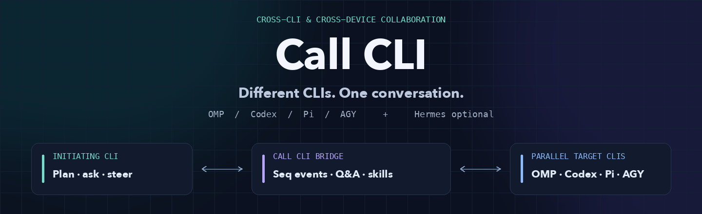

<div align="center">



**给你的 CLI 一个搭档，而不只是另一个子进程。**

<a href="README.md">English</a> · <a href="README.zh-CN.md"><strong>简体中文</strong></a>

<a href="VERIFICATION.md"></a>
<a href="https://github.com/openclaw/acpx"></a>
<a href="LICENSE"></a>

[快速开始](#快速开始) · [核心能力](#核心能力) · [选择接入方式](#选择接入方式) · [工作原理](#工作原理) · [文档](#文档)

</div>

---

Call CLI 通过轻量协调层连接 **OMP、Codex、Pi 和 AGY**。新建协作会话、跟进实时进展、回答对方编号提问、按任务固定传递技能，并在执行期间调整方向——**既能在本机运行，也能通过你现有的 SSH 跨设备协作。**

**不强制依赖 Hermes，不新增常驻服务，不接管你已经手动打开的终端或桌面 GUI 会话。**

## 为什么需要 Call CLI

你在一个 CLI 里规划，让同机或远端机器上的另一个 agent 实现，再交给第三个 agent 审查。问题回答、技能包传递和中途改向都通过发起端 CLI 往返，不必在多个终端之间手工复制粘贴。

| | 能力 | 带来的变化 |
| :-- | :-- | :-- |
| 💬 | **多轮问答与执行期改向** | 用 `reply` 按问题编号作答，或用 `intervene` 在同一目标会话内取消旧轮并按新方向续轮。 |
| 📡 | **可续读的事件流** | 基于持久游标 `seq` 的短等待（`wait` / `events --after SEQ`）返回阶段、去重后的安全工具状态、待答 `question_ids` 与结果尾部 `answer_tail`。 |
| 🤝 | **多 CLI 并发与隔离** | 以独立 client/task/session 身份并行运行 AGY、OMP、Codex、Pi，由单写者目录占用（`--write`、`--resource`）防止写冲突。 |
| 🤖 | **原生 AGY 支持与默认工具放行** | 通过 `models.cjs` 发现精确 ACP 模型，新 AGY 任务默认持久化 `approve-all` 放行任务范围内工具，未恢复的工具失败如实结算为 `unknown`。 |
| 📦 | **按任务固定传递技能** | Hermes 或任意发起 CLI 均可传递 `required`、`optional`、`reference` 技能（支持 `origin` 与 `target`），跨轮固定 SHA-256 并记录 `CALLCLI_SKILL` 回执。 |
| 🔌 | **模块化后端适配器** | 公共任务/轮次协调（`bridge.py`、`runner.py`）与 ACPX/AGY 适配解耦，通过 `backends.py` 注册扩展，未来后端不强制要求 ACP。 |

<a id="快速开始"></a>
## 快速开始

### 让 AI 帮你配置

将下面这段提示词交给你正在使用的 OMP、Codex、Pi 或 Hermes：

```text
请读取 https://github.com/Loveacup/call-cli 中的 README 和
docs/configuration.md，为当前 CLI 配置 Call CLI。

先发现现有安装、SSH 别名、登录与工作目录，只安装我需要的入口、技能或模块。
保留已有文件与凭据，不新建常驻服务。开始任务前，说明首轮 npm 版本检查；升级作为单独授权的维护动作。

用真实只读协作验证安装，关闭自有测试会话，报告可用范围和剩余阻塞。
```

配置手册是 **写给 AI 的执行说明**，不是让你手工填写的新配置文件或问卷。详细 AI 手册目前以**简体中文**维护；中英文 README 覆盖完全一致的命令、参数与边界。

<details>
<summary><strong>更习惯终端？直接从源码运行。</strong></summary>

#### 环境要求

- **协调主机：** 支持 `fcntl` 的 POSIX Python 3.9+。核心链路已在 macOS 完成端到端验证；Windows 可作为发起客户端或执行设备，不作为 Python 协调主机。
- **执行设备：** Node.js、npm、ACPX，以及已完成适配和登录的目标 CLI（`omp`、`codex`、`pi` 或 `agy`）。
- **版本兼容：** 需要公开导出 `acpx/runtime` 的 ACPX Shared Runtime。本机 AGY/OMP/技能传递续轮已在 **0.22.0** 实测（跨设备 Windows SSH OMP 在 **0.21.1** 实测，历史基线 **0.20.0**），不硬编码锁死单一版本号。适配配置与平台边界见 [AI 配置手册](docs/configuration.md)。

```sh
git clone https://github.com/Loveacup/call-cli.git
cd call-cli
python3 collab.py --help
python3 collab.py start --help
acpx --version
```

Call CLI 当前按源码分发，没有单独发布的 Call CLI npm/pip 包或一键全局安装脚本。

#### 启动一个只读协作

在源码检出目录、同一个 POSIX shell 中执行（以下示例不授予写权限）：

```sh
CALL_CLI_HOME="$PWD"
CALL_CLI_DB="$HOME/.local/state/call-cli/tasks.sqlite3"

CLIENT_ID="$(python3 "$CALL_CLI_HOME/collab.py" --db "$CALL_CLI_DB" \
  connect --runtime omp | python3 -c 'import json,sys; print(json.load(sys.stdin)["client_id"])')"

TASK_ID="$(python3 "$CALL_CLI_HOME/collab.py" --db "$CALL_CLI_DB" \
  --client "$CLIENT_ID" start --device local --agent omp --cwd "$PWD" \
  --timeout 120 --prompt 'Read this project and summarize its main entry points. Do not modify files.' \
  | python3 -c 'import json,sys; print(json.load(sys.stdin)["id"])')"

python3 "$CALL_CLI_HOME/collab.py" --db "$CALL_CLI_DB" --client "$CLIENT_ID" \
  wait --task "$TASK_ID" --after 0 --timeout 5
```

保存返回的真实 `client_id`、`id`（`TASK_ID`）和 `after` 游标：

- **跟进进展与回答问题：** 继续用更新后的 `--after` 调用短 `wait`。若目标提出问题（`waiting_reply`），按准确问题编号执行 `reply --task "$TASK_ID" --question-id QUESTION_ID --prompt '...'`。
- **执行期主动改向：** 调用 `intervene --task "$TASK_ID" --command-id STABLE_ID --prompt '...'`，继续短 `wait` 驱动协调端取消旧轮、确认结算并在同一会话启动修订轮。
- **调用 AGY 或附带任务技能：** 先发现模型，将 `MODEL_ID` 设为输出中的精确 ID；下面的技能路径需替换为你已检查且愿意传递的目录。

```sh
# 先在执行设备发现当前广告的精确 ACP 模型 ID
node "$CALL_CLI_HOME/models.cjs" "$PWD"

# 启动 AGY 任务并传递协调端固定的技能包
python3 "$CALL_CLI_HOME/collab.py" --db "$CALL_CLI_DB" --client "$CLIENT_ID" \
  start --device local --agent agy --model "$MODEL_ID" --cwd "$PWD" \
  --skill required=/absolute/path/to/skill-dir \
  --prompt 'Follow the passed skill and inspect the repository read-only.'
```

- **验收并关闭：** 当前轮结算（`completed` 或 `cancelled`）并核验结果后，执行 `close --task "$TASK_ID"`。关闭正在运行的任务不能替代取消。

`client_id` 是本地协作句柄；`--runtime omp` 只是发起端声明，不是已认证的原生宿主身份。完整生命周期命令见[在线协作手册](docs/usage.md)。

</details>

> **版本检查不是自动升级：** 每个逻辑新任务只查询一次 `installed`/`latest` 并持久保存结果。正常派工绝不自动安装包；单独授权的维护升级必须等待设备无活动任务。[查看细节](docs/configuration.md#acpx-版本检查与更新)

<a id="核心能力"></a>
## 核心能力

### 1. AGY 支持与默认工具放行

- **实时模型发现：** 在执行设备运行 `node models.cjs /absolute/workdir`（调用 ACPX 公共 `inspectAgentModels`），由发起端选定精确候选后传入 `--agent agy --model ID`（Hermes：`agent: "agy", model: "ID"`）。可选 `--effort VALUE` 使用当前元数据广告的 `thought_level`，不从模型名猜测或剥离后缀。用户显式指定优先；所选模型/effort 持久保存在任务中并在每轮执行前读回核验，不可用时直接报错停止，不静默切换 provider。
- **默认 `approve-all` 审批与写占用分离：** 新建 AGY 任务默认持久化 `agy_approval: "approve-all"`（即使 `write` 为 `false`），放行任务范围内的授权 shell 与原生工具，同时提示词优先引导使用原生 read/search 工具。若需严格只读审批，显式传入 `--agy-approval approve-reads`（Hermes：`agy_approval: "approve-reads"`），此时 shell/写入权限请求会被非交互拒绝。审批策略与 `write: false` **都不是操作系统或文件系统沙箱**；获授权修改文件仍须另传 `--write` 以声明编辑权限并占用工作区。`reply`/`intervene` 保留该策略；旧任务缺省字段仍按原 `write` 映射，OMP/Codex/Pi 默认策略（缺省 `approve-reads`，`--write` 选 `approve-all`）不变。
- **如实结算结果：** 若 AGY 工具调用失败且最后一次工具事件后既无最终回答也无待答问题，或公开输出最后一个非空行恰为致命错误标记 `⚠ Agent execution terminated due to error.`，即使协议层返回 `end_turn` / exit `0` 也会结算为 `unknown`（不自动重放）。待答问题仍保留 `waiting_reply` 可正常回复（致命错误最终行仍优先覆盖）；工具失败后若恢复并给出最终回答则可正常完成。公开事件只保留安全工具标识、类别与状态；当前公共 Shared Runtime 事件不暴露权限决策，诊断统一标记为 `unobservable`，不把工具失败臆测为权限拒绝。详见 [AGY 模型与审批工作流](skill/references/agy-models.md)。

### 2. 任务技能传递（Hermes 与任意发起 CLI 通用）

- **发起端通用的公共契约：** 无论从 Hermes 还是从 OMP、Codex、Pi 及终端脚本发起，都可通过同一 `start` 契约向目标传递技能：可重复的 `--skill MODE=PATH`（`location: "origin"`，协调端技能目录）、`--target-skill MODE=PATH`（`location: "target"`，执行端已有技能目录，含 Windows 绝对路径），或 `--skills-json ARRAY`（Hermes / Python `Collaboration.start` 的 `skills` 数组）。
- **本地优先与公开检索线索：** 发起端先查找本地合适技能并实际阅读 `SKILL.md`、相对引用/脚本与依赖要求。本地不足再检索公开技能（如 `hermes skills search` 或 GitHub 搜索）：仓库 star 数与最近实质内容更新（区分真正的方法/脚本更新与仅改 license、格式或权限位的提交）作为筛选线索而非唯一质量证明。选定公开技能后在 scratch 固定具体 commit SHA 并记录到 `source` 元数据，不以全局安装替代任务级固定版本。
- **三种传递模式（`required` / `optional` / `reference`）：**
  - `required`：目标必须实际读取 `SKILL.md` 及所需资源并按适用方法执行；不适用或缺少依赖须如实报告 `not_applicable` / `unavailable`。若 `required` 技能暂存失败，不会提交业务 prompt。
  - `optional`：目标按任务价值读取和采用，未采用时说明原因（`not_adopted`）。
  - `reference`：作为非约束性参考材料按需查阅。
- **本地/远端（`origin` / `target`）固定暂存与回执：** `origin` 技能在任务创建时生成每文件 SHA-256 清单与协调端私有快照（自动跳过点文件、`node_modules`、`__pycache__`、符号链接及常见密钥文件名，上限为单文件 4 MiB、单技能 16 MiB、1000 个文件），每轮通过既有本机/SSH 通道暂存到执行端临时目录 `call-cli-skills/<task>/<skill>/<sha>/`。`target` 技能在首次暂存时固定执行端原目录字节与 SHA。`reply`/`intervene` 续轮复用同一固定快照；`close` 成功后删除协调端快照并清理执行端临时目录。目标每轮结束前输出 `CALLCLI_SKILL <id> <read|adopted|not_adopted|not_applicable|unavailable> <具体原因或证据>`；缺少 `required` 回执仅标记 `skill_verification: "unverified"`（列入 `skill_report_missing`），不会把已完成的有效业务结果改写为 `unknown`。
- **读取边界：** ACPX 0.22.0 的 `fs/read_text_file` 回调仅允许读取 `cwd` 子树内路径，而 agent 原生文件读取工具（已在 macOS/Windows OMP 与 macOS AGY 实测）可直接读取上述临时目录，无需污染项目 `cwd`。仅依赖受限回调的目标应如实报告 `unavailable`，不扩大权限或写入用户工作区。详见[技能选择与传递指南](skill/references/skill-passing.md)。

### 3. 多 CLI 并发、可续读事件与模块化后端

- **多 CLI 并发与单写者保护：** 同一设备或跨 SSH 可同时运行多个 CLI 任务（如 AGY 与 OMP 并发协作），按 origin/client/task/session 严格隔离。`--write` 与可选跨设备 `--resource` 提供单写者目录占用保护；只读任务（包括 `write: false` 下默认 `approve-all` 的 AGY 任务）可与另一任务的合法写者安全并存。
- **可续读事件与原子结算：** runner 通知与 `events`/`wait` 共享持久 `seq` 游标。同一工具的重复状态自动去重（普通工具状态通知每轮有界，失败状态不受限，完整记录均可经 `events` 查询）。每轮结束时在同一个 SQLite 事务内原子提交任务状态与唯一 `<turn>:settled` 事件（附带 `question_ids`、`answer_tail` 及待执行介入的下一步提示），即使 stdout 观察中断也能通过游标补读恢复。
- **模块化后端扩展接口：** `bridge.py` 与 `runner.py` 负责任务归属、状态机、轮次、介入与目录占用，与具体执行协议解耦。`backends.py` 统一注册实现 `prepare_start(model, effort, approval)`、`run(store, task, emit)` 与 `control(task, action, timeout)` 的后端适配器。当前 `acpx_backend.py` 与 `agy.py` 承载 ACPX Shared Runtime 和 AGY 策略；新增后端（包括非 ACP 后端，见 `test_backends.py` 中的非 ACP fake 完整生命周期契约）只需注册适配器并随 runner 部署，不引入守护进程或独立状态库。详见[后端扩展接口](docs/integrations.md#后端扩展接口)。

<a id="选择接入方式"></a>
## 选择接入方式

| 你在哪里工作 | 使用方式 | 能力范围 |
| :-- | :-- | :-- |
| 普通终端／脚本 | `python3 collab.py` | 完整通用协调入口（`connect`、`start`、`list`、`status`、`events`、`wait`、`reply`、`intervene`、`cancel`、`close`）。 |
| OMP、Codex、Pi | `skill/` 技能包 + 已配置的入口 | 由 AI 执行跨 CLI 协作与技能传递；技能本身不安装依赖，也不代替目标 CLI 登录。 |
| 其他机器 | `remote-client.cjs` | 通过一次性 SSH 调用协调主机。 |
| Windows 受限 Codex 环境 | `remote-client.ps1` | 针对已观察到的 Node spawn SSH `EPERM` 提供原生 PowerShell/.NET 客户端；当前仅核验 macOS 协调端。 |
| Hermes | 可选 `call_cli` 插件 | 原生来源绑定、后台通知、技能传递与取消结算后同会话 `intervene`。新工具 schema 需新开 Hermes 会话加载；宿主当前会话消费与 Telegram 投递（Issue #1）仍需单独验收。 |

**终端安装与 CLI 内加载属于同一条配置路径的不同步骤。** [集成手册](docs/integrations.md)说明了必须一起部署的运行时文件清单、AI 加载技能或插件的方式，以及如何验证真实入口而不叠加冲突副本。

<a id="工作原理"></a>
## 工作原理

```text
发起 CLI                          Call CLI                        目标 CLI
   │                                │                               │
   ├──── 新建任务（含可选技能包）────►│──── 本机 / SSH + ACPX ────────►│
   │◄─── 阶段 / 工具 / 编号提问 ─────┤◄─── 公开事件（持久 seq）────────┤
   ├──── 回答 (reply) / 介入 ───────►│──── 同会话续轮 + 固定技能 ────►│
   │◄─── 最终结果 + 技能回执 ────────┤◄─── 权威轮次结果 turn.result ──┤
```

协调端维护轻量 SQLite 任务库与有界单轮 runner。ACPX 负责原生会话生命周期与 queue-owner 串行化，通过公开的 `acpx/runtime` API 返回权威 `turn.result`。公开事件用于展示进度、工具状态、技能回执和编号问答，不用于猜测最终结算。

执行期改向遵循明确契约：**提交 `intervene` → 取消当前运行轮 → 确认取消结算 → 在同一原生会话启动新轮 → 核验修订结果**。这不代表对任意外部命令都能无损热修改或暂停/恢复子进程。

<a id="文档"></a>
## 文档

### 给实际操作 Call CLI 的 AI

| 手册 | 内容 | 语言 |
| :-- | :-- | :-- |
| [安装与配置](docs/configuration.md) | 环境发现、SSH、适配器、认证、权限与交付验证。 | 简体中文 |
| [CLI／模块接入](docs/integrations.md) | 技能安装、可选 Hermes 插件、完整运行时清单与后端扩展接口。 | 简体中文 |
| [在线协作](docs/usage.md) | 游标续读、多轮问答、执行期介入、取消、验收与关闭。 | 简体中文 |
| [任务技能传递](skill/references/skill-passing.md) | 本地优先选择、公开仓库线索、`required`/`optional`/`reference` 模式、暂存与 `CALLCLI_SKILL` 回执。 | 简体中文 |
| [AGY 模型与审批](skill/references/agy-models.md) | `models.cjs` 模型发现、显式 `model`/`effort`、持久 `approve-all` 与结果诊断。 | 简体中文 |
| [Windows Codex SSH](CODEX_SSH.md) | 桌面上下文执行与原生 PowerShell 客户端模板。 | 简体中文 |

### 给使用者和贡献者

[验证说明](VERIFICATION.md) · [路线图](ROADMAP.md) · [安全说明](SECURITY.md) · [贡献指南](CONTRIBUTING.md)

<details>
<summary><strong>授权前请阅读：范围与安全边界</strong></summary>

- **只新建协作会话。** 绝不接管用户已经手动打开的终端、TUI 或桌面 GUI。
- `queued` / `pending` 仅代表已提交，不代表已生效。遇到 `unknown` / `DO_NOT_REPLAY` 先与原会话和工作区对账，再决定是否重试。
- OMP/Codex/Pi 默认 `approve-reads`，传 `--write` 时使用 `approve-all`；新 AGY 任务默认持久化 `agy_approval: "approve-all"`（可显式指定 `approve-reads`）。审批策略和 `write: false` **都不是文件系统沙箱**；SSH 与目标 CLI 仍拥有当前系统账号的权限。
- 技能暂存会自动跳过点文件、符号链接、`node_modules`、`__pycache__` 与常见私钥文件名并限制体积/文件数，但它**不是恶意代码沙箱或自动隐私审计**；只传递本任务需要且允许目标模型读取的目录。
- 任务库、client 句柄、提示词、回答与认证保存在用户私有目录。“公开事件”指非内部协调事件，不代表内容已脱敏。
- 由单个 POSIX 协调主机持有状态与锁，不承诺跨协调主机分布式锁、进程崩溃后的 stdout 通知重放或离开当前协作后的自动唤醒。
- 源码测试、本机已安装入口实测、跨设备探测与真实宿主/Telegram 投递各自证明不同边界，详见[验证说明](VERIFICATION.md)。

</details>

<a id="开发与验证"></a>
## 开发与验证

Python 协调核心仅使用标准库。当前新增能力——包括 AGY 模型/effort 转发与默认 `approve-all` 持久策略、模块化后端适配器、可续读原子结算事件、本机 AGY + OMP 并发协作，以及任务技能传递——已完成本机安装与真实调用验证，并配合源码级跨设备 Windows SSH OMP 技能传递实测与离线/合成测试套件验证。已打开的旧 Hermes 会话需新开会话才能加载更新后的工具 schema，Telegram 空通知问题（Issue #1）与上游 AGY 错误输出（Issue #2）仍保持开放待独立验收；详细证据边界见 [VERIFICATION.md](VERIFICATION.md)。

```sh
python3 -B -m unittest discover -v
node --test test_skill_stage.cjs test_shared_prompt.cjs test_models.cjs test_codex_ssh.cjs
# Optional: owned native ACPX sessions with synthetic endpoint (no live model call)
RUN_NATIVE_ACPX_TESTS=1 python3 -B -m unittest test_native_skills test_native_shared -v
```

真实模型与跨设备验证需要明确执行授权和现有目标 CLI 登录，私有运行记录不随源码分发。`docs/assets/` 中的可选横幅渲染脚本使用 Pillow，**不属于运行时依赖**。

## 致谢

基于 [ACPX](https://github.com/openclaw/acpx) 与各目标 CLI 的原生能力构建，Call CLI 不隶属于这些项目。

<div align="center">

**工具各有长处，协作保持同向。**

[MIT 许可证](LICENSE) · [English](README.md)

</div>
